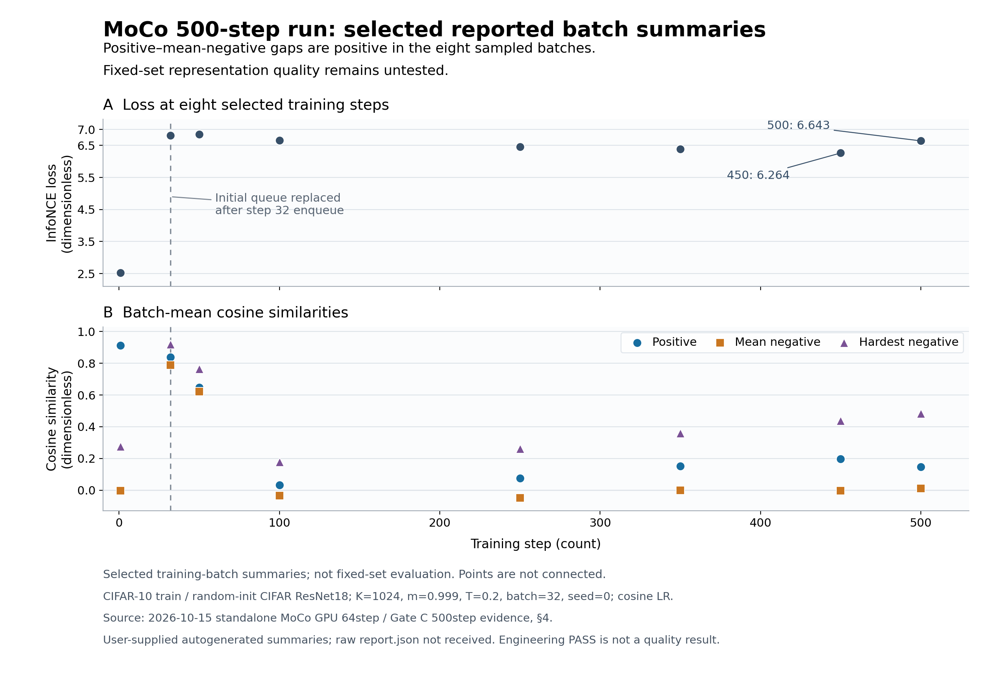

# MTG資料：LoRA・MoCo単体検証の進捗と段階的統合

作成日・情報確認日：2026-10-15。対象MTGの日付は未指定。

## 前回MTGの振り返り（2026-10-08）

前回は、画像事前学習済みViTのBaseを固定し、ActivityNetを時間順に入力してQ/V LoRAをMoCoで学習する実験と、Base ViT・学習済みLoRA付きViTをLinear Probeで比較する計画を共有した。主な議論は、学習中の異常を切り分け、各部品を理解・検証してから統合実験へ戻る進め方だった。

| 話題 | 前回の議論・合意した方針 |
|---|---|
| 学習中の問題 | MoCo lossの大きな振動と、Query LoRA勾配の途中からの急増を確認。実装・データ・入力条件・MoCo設定のどこに原因があるかは未特定だった。 |
| 検証の進め方 | LoRA、MoCo、Sequential Loaderを単体で確認してから統合する。LoRAは注入先・forward・勾配・更新・Base固定、MoCoは標準的な入力でloss・類似度・Queueの基準挙動を確認する。 |
| LoRA実装の選び直し | 出所と挙動を十分に説明できない実装を基盤として使い続けず、Hugging Face PEFTや研究室内で実績のある簡潔な実装を調査する。採用方式はその時点では未決定だった。 |
| 入力条件の診断 | strideを変更できるようにすることや、オンライン入力・データ順序の影響を調べる案を検討した。参照MoCoの実行で基準となるログを得る案も挙がった。 |
| Linear Probeの扱い | 異常の原因を確認・切り分けるまで、比較結果を研究上の結論として扱わない。frame特徴のMaskedMeanによる分類改善だけでは、時間順序や動きの理解を示せない。 |
| 研究室紹介 | 一般的なオフライン学習から始め、shuffle制約、メモリ制約、近接frameの冗長性などオンライン学習の難しさを示して、自分の研究へつなげる構成にする。 |

**前回から持ち越した問いは、loss振動・勾配急増の原因と、統合実験・Linear Probeを再開する条件である。** 今回は、この方針を受けて進めたLoRA・MoCo単体検証の結果を報告し、次の接続・統合の順序を相談する。

出典：[2026-10-08 MTG議事録](../meetings/2026-10-08-mtg.md)。

## 0. 今回のMTGで先生に相談したいこと

1. **MoCo単体の500step工学検証を、Frozen ViTへ接続するための基準として採用してよいか。** 特徴表現の有用性は未検証であり、表現評価を先に行うか、接続確認と別に進めるかを相談したい。
2. **MoCo → Frozen ViT → 固定動画chunk → Sequential Loader → 自作LoRA、という段階的統合で進めてよいか。** Loaderを入れる前後で同じ入力を比較し、異常の原因を絞れる構成にしたい。
3. **動画MoCoの診断とLinear Probeを再開する条件をどこに置くか。** 数値的な成立、LoRA更新、入力・Queueの対応を確認したうえで、どこまで問題を解消すれば研究上の比較へ進めるかを決めたい。

## 1. 現時点の結論

**前回MTGで指摘された統合経路を分解し、LoRAの更新・凍結とMoCoの計算・EMA・Queueを単体で確認するところまで進んだ。MoCoは実CIFAR-10の500stepで工学的PASSを得た。一方、以前の動画MoCoにおけるloss振動・Query LoRA勾配急増の原因は未特定である。**

| 対象 | 今回報告できること | 残っていること |
|---|---|---|
| 自作LoRA | 実ViTを使うCPU検証でQ/Vへの注入、A/B更新、Base不変を確認 | 実画像学習の完了報告とrun成果物の対応付け、MoCoとの結合 |
| MoCo単体 | CPU 20step、GPU 64/500stepで更新・EMA・Queue・保存復元が整合 | 識別的な特徴表現を獲得したかの評価 |
| 動画統合経路 | 前回の問題に対し、部品を分離した比較基準を得た | Frozen ViT・Loader・自作LoRAを加えた条件での再検証と原因特定 |

ここでの「工学的PASS」は、検証した範囲で計算・更新・保存復元の条件を満たしたという意味である。分類性能の改善や時間情報の獲得を示す判定ではない。

## 2. 前回MTGからの流れ

研究の目的は、画像事前学習済みモデルへ動画を逐次入力し、LoRAが獲得する静的・動的情報を解析して活用することである。その前提として、学習経路を説明・検証できる状態にする必要がある。

10月8日のMTGでは、ActivityNetを時間順に入力する統合MoCoでlossの振動とQuery LoRA勾配の途中からの急増があり、Linear Probeの解釈を保留した。LoRA・MoCo・Sequential Loaderを切り離し、小さな構成で確認してから再統合する方針になった。

今回の資料は、その方針に対する**単体検証の進捗報告と、再統合の進め方の相談**である。

## 3. Evidence：自作LoRAの単体検証

### 3.1 実ViT・CPUで確認済みの内容

10月13日の実装・検証記録では、実checkpointの `google/vit-base-patch16-224` を使い、以下を確認した。

- Q/K/Vの全7非空組合せへの注入と対象module数。研究で使うQ/Vは**24 module、48 tensor、294,912 parameter**。
- Aをランダム、Bをゼロで初期化し、初期状態でLoRA ON/OFFのCLS出力が一致。
- Q/V LoRAの**1step目はBが更新され、2step目でAも更新される**。Bゼロ初期化では、初回A勾配0は期待される挙動である。
- Baseに勾配がなく、更新前後のBase重みが完全一致。Optimizer対象集合も期待値と一致。
- 新規73テストがPASS。偽CIFAR-10と小ViTによる3stepでは、保存・再読込のlogits一致とseed再現も確認。

10月14日のEvidence出力specの進捗記録では、JSON・loss/A/B勾配図・Markdownの自動出力をCPUテストで確認した（新規7件＋既存26件＝33件PASS）。これは実画像runの数値結果とは区別する。

### 3.2 実CIFAR-10学習の報告とEvidenceの境界

10月14日の壁打ちメモには、**ユーザーからCIFAR-10での学習・Base凍結・監査証拠作成ができたという完了報告**がある。一方、その相談では最新runの `verification_summary.md`、図、`report.json`、対応Git HEAD/dirtyは未提出と記録されている。

したがって、本資料では実画像確認の完了報告を認めつつ、lossの具体値やA/B勾配の実測値は確定しない。10月13日の実装記録と10月14日の出力specに残る「実画像run未実施」は、それらの記録時点の状態として扱う。報告用には、最新runの条件・revision・成果物を対応付けたい。

また、CIFAR-10分類の検証経路は**LoRAと分類Headの学習**である。仮に分類lossが下がっていても、それだけでLoRAの寄与や動画の時間情報獲得を示すことはできない。

根拠：[LoRA実装・検証記録](../experiments/2026-10-13-standalone-vit-lora-implementation-verification.md)、[Evidence出力spec](../specs/2026-10-14-standalone-vit-lora-mtg-evidence-auto-output-spec.md)、[10月14日の完了報告を含むメモ](../../../../secretary/notes/brainstorm/2026-10-14-post-lora-standalone-next-moco-validation.md)。

## 4. Evidence：MoCo単体の実画像検証

### 4.1 検証条件とGateの到達点

**LoRA・ViT・Sequential Loaderを外した構成**で検証した。CIFAR-10 train、ランダム初期化のCIFAR仕様ResNet18、Projector `512→512→128`、batch32、seed0。CIFARの分類ラベルは学習lossに使っていない。

MoCoはQueue容量1,024、EMA係数0.999、temperature 0.2。SGDは初期LR 0.00375、momentum 0.9、weight decay 0.0001。Queueは正規化したランダムkeyで満たして開始し、Key-forward直前EMA、旧Queueでlogits計算、current Key enqueue、backward、Query更新の順序を採用した。

| 検証 | 実行範囲 | 確認結果 |
|---|---|---|
| Gate A：数学・機構 | MoCo関連42テスト | PASS。InfoNCE、EMA、Queueなどの確認 |
| Gate B：実画像smoke | CPU・20step・固定LR | 全14チェックPASS、checkpoint復元PASS |
| Queue置換診断 | GPU・64step・固定LR・fresh run | 全14チェックPASS。step32のenqueue後にrandom keyが0 |
| Gate C：継続pilot | GPU・500step・cosine LR・fresh run | 工学的PASS、全14チェックPASS、checkpoint復元PASS |
| 非回帰 | 既存LoRA関連32テスト | PASS。今回の実画像run内のチェックとは別のテスト |

実画像runは同じcleanな `dev` commit `8939d7fca7d1cc3367b437c5f6adb48dd8e86f4a` に対応する。GPU 64stepと500stepはそれぞれ別のfresh runであり、step数に加えてschedulerも異なる。後半のlossを同条件の性能比較として扱わない。

GPU runの14チェックには、Key勾配0、Query Backbone/Projector更新、全stepの有限性、EMA式の許容誤差内一致、Queueのpointer/count・正規化、sample順序、保存復元が含まれる。500stepのEMA最大誤差は約 `1.30e-7`、Queue列ノルム最大誤差は約 `1.19e-7` で、検証条件を満たした。

**Evidenceの出所：** 実画像runの判定と数値は、既存実験メモに収録されたユーザー提出の自動生成サマリーに基づく。raw `report.json`、元PNG、checkpointバイナリを今回直接検査した結果ではない。42/32テストのPASSは別途提出されたテスト出力に基づく。

### 4.2 500stepで観測されたloss・類似度

この図で見る点は、**Queue置換後もlossが一方向に改善したとは言えず、PositiveとHardest Negativeの分離には未解決点があること**である。

図はサマリーに掲載された8時点の点を示す。全500stepの連続系列ではなく、各点は異なるtraining batchと変動するQueueでの測定である。固定評価集合での性能推移ではない。step32のQueue完全置換はenqueue後の状態であり、そのstepのlossはenqueue前のQueueから計算されている。

| step | InfoNCE loss | Positive cosine | Mean Negative cosine | Hardest Negative cosine |
|---:|---:|---:|---:|---:|
| 1 | 2.5275 | 0.9124 | -0.0044 | 0.2754 |
| 32 | 6.8179 | 0.8388 | 0.7881 | 0.9207 |
| 100 | 6.6620 | 0.0329 | -0.0342 | 0.1772 |
| 450 | 6.2642 | 0.1965 | -0.0041 | 0.4377 |
| 500 | 6.6430 | 0.1466 | 0.0101 | 0.4834 |

cosineは無次元、値はbatch集計値。Hardest Negativeは各sampleの最も類似するNegativeについてのbatch平均である。掲載値は小数第4位に丸めた。

- 全500stepの最大lossは**7.00383（step42）**。step450では6.26424、最終step500では6.64295。全期間の収束や単調改善は実証されていない。
- 最終stepではPositive−Mean Negativeが**+0.136443**、Positive−Hardest Negativeが**−0.336870**。平均的なNegativeとの距離と、最も紛らわしいNegativeとの距離で見立てが異なる。
- Query Backbone勾配normは最大4.79676、中央値3.26037。後半の上昇はあるが、今回のサマリーで非有限値や急激な数値爆発は報告されていない。以前の動画MoCoの勾配問題が解消されたという意味ではない。
- 最終stepのQuery Backbone更新normは約 `2.24e-7`。cosine LRが約 `3.70e-8`まで下がる条件なので、非ゼロ勾配と小さい更新量の併存だけではOptimizer異常と言えない。

根拠：[CPU 20stepの追加Evidence](../experiments/2026-10-15-standalone-moco-cifar10-gate-abd-console-evidence.md)、[GPU 64/500stepのEvidence](../experiments/2026-10-15-standalone-moco-gpu-64step-and-gate-c-500step-evidence.md)。

## 5. Interpretation：何が分かり、何が残るか

**MoCoの更新機構を切り分ける基準は得られた。** LoRAも動画Loaderも含まない条件で、500stepまでEMA・Queue・Optimizerの整合を確認できたため、次の接続で不具合が生じたときに比較する対照として使える。

**初期loss上昇にはQueueの置換が関係している可能性がある。** ランダムNegativeが実画像Keyへ置換される時期とloss上昇が重なる。ただし、それだけで後半の変化まで説明できるとは限らず、特徴空間・augmentation・BatchNorm・最適化の影響は残る。

**表現品質は別に評価する必要がある。** Positive平均がHardest Negative平均を下回る観測は、難しいNegativeとの分離に課題があることを示唆するが、全sampleの失敗や表現崩壊を証明しない。非ゼロのbatch varianceだけでも崩壊なしを保証できない。固定画像集合でのPositive順位・margin、特徴分散や有効rank、必要に応じたheld-out linear evaluationが候補となる。

以前の動画統合条件とは、dataset、Backbone、学習対象、augmentation、Optimizer、Queue初期化・容量、temperature、EMA/enqueue順序が異なる。今回のlossや勾配を旧runの数値と直接比較して、原因を断定することはできない。

## 6. 方針候補：差分を整理して段階的に統合する

以下は**先生に相談する提案**であり、承認済みの実装specや実施済み実験ではない。10月15日の段階的統合メモを、現在のMoCo検証結果に合わせて整理した。

| 段階 | 構成・入力 | 主に確認すること |
|---|---|---|
| ① 単体の基準 | CIFAR-10＋ResNet18＋MoCo | 今回の工学的PASSと設定を基準として保持 |
| ② Frozen ViT接続 | 通常画像Loader＋Frozen ViT、Query Projectorのみ学習 | ViT入力224×224、CLS 768→Projection 128、凍結・勾配・EMAの境界 |
| ③ 動画chunk化 | Loaderを介さない固定16-frame chunk＋同じViT＋MaskedMean | valid/padding除外、集約、Projectorへの勾配 |
| ④ Loader接続 | ③と同じraw frame・timestamp・順序をSequential Loader経由にする | 入力、特徴、logits、loss、勾配、更新・Queueの許容誤差内一致 |
| ⑤ 自作LoRA追加 | ④へQ/V LoRAを加え、Base凍結を維持 | Query A/B・Projector更新、Key勾配0・EMA、Base不変、2step以上 |
| ⑥ 逐次stream診断 | strict-single、研究対象の動画順序 | same-video Negative、stride、入力非定常性と勾配変化 |

①→②ではBackbone、事前学習、入力解像度、学習対象が変わるため、lossの数値一致や性能同等を要求しない。②以降はFrozen BaseとProjector学習を維持し、**③→④で入力と初期状態を揃えてLoaderの影響を比較できること**を重視する。

MoCoのQueue初期化・EMA・enqueue順序は今回の承認specを基準に保持する。探索メモに残る旧来のoptimizer後EMAなどを無条件に引き継がない。画像から動画へ進む際の2-view、Negative policy、前処理、step数・許容誤差は、次のspecで明示したい。

⑤で問題が出た場合は、同じ固定chunkで「Loaderを介さないMoCo＋LoRA」を比較する。両経路で失敗するか、Loader経由だけで失敗するかを見る。LoRA追加後のlossが④と一致することは合格条件にしない。

### 進め方の比較

| 候補 | 得られるもの | 判断したい点 |
|---|---|---|
| A：MoCoの固定評価を先行 | 接続前に表現品質の疑問を調べられる | 今回の研究に必要な評価水準と追加工数 |
| B：Frozen ViT接続を先行 | 研究構成へ戻るための次の工学的差分を確認できる | 単体MoCoの表現評価を別Gateとして残してよいか |
| C：全構成を結合して長時間run | End-to-endの挙動を観測できる | 異常時の原因を絞りにくいため、今回の再開候補としては推奨しない |

**相談用の推奨はB。** 接続の成立と表現品質を別の判定として進め、必要な固定評価は目的を絞って計画する。以前の異常の原因特定が完了したとは扱わない。

## 7. 今回言えること／まだ言えないこと

| 今回言えること | まだ言えないこと |
|---|---|
| 実ViT・CPUで自作LoRAの初期出力、A/B更新、Base不変を確認した | 実CIFAR LoRA runの具体的なloss・勾配値を、本資料で成果物と照合できた |
| MoCo単体は提出サマリー上、500stepで有限性と更新機構の工学条件を満たした | MoCoが分類に有用な特徴を学習した、表現崩壊がない |
| 再統合で比較する独立MoCoの基準を得た | 以前のloss振動・LoRA勾配急増の原因を特定・解消した |
| 段階的に接続すれば比較対象を設定できる | 現在の自作LoRA＋MoCo＋Sequential Loader経路が検証済みである |
| Linear Probeは条件を揃えた動作分類特徴の比較に使う候補である | Linear Probeの改善だけで時間順序や動きの理解を証明できる |

各frameのCLSをMaskedMeanする特徴定義は、chunk内のframe順序を入れ替えても集約値が変わらない。時間情報を主張するには、順序・動きに対する別の評価が必要である。

## 8. Ask：MTGで決めたいことと次に進む候補

- **次の主課題：** MoCoの固定評価を先に置くか、Frozen ViT＋MoCoの接続確認へ進むか。
- **統合の順序：** ③→④の同一入力比較を挟み、LoaderとLoRAを段階的に加える案でよいか。
- **Linear Probe再開条件：** 工学チェックの合格、LoRA A/B更新・Base不変、入力とQueueの対応、勾配急増の診断結果のうち、必須条件を合意したい。
- **報告の根拠：** LoRA最新runのサマリー・図・設定・revisionを対応付け、今回のMoCo結果と同じ粒度で提示したい。

合意後の候補は、Frozen ViT接続のspec化 → 小規模な接続確認 → 固定動画chunkとLoader経路の比較である。長時間ActivityNet runやLinear Probeは、再開条件を満たしてから検討する。

## 9. 参照ファイル・図

### 研究状況・前回MTG

- [プロジェクトREADME](../README.md)
- [2026-10-08 MTG議事録](../meetings/2026-10-08-mtg.md)

### LoRAの設計・検証・完了報告

- [Standalone ViT-LoRA検証spec](../specs/2026-10-13-standalone-vit-lora-cifar10-verification-spec.md)
- [LoRA実装・CPU検証記録](../experiments/2026-10-13-standalone-vit-lora-implementation-verification.md)
- [教授向けEvidence自動出力spec・進捗](../specs/2026-10-14-standalone-vit-lora-mtg-evidence-auto-output-spec.md)
- [LoRA確認後のMoCo単体検証メモ](../../../../secretary/notes/brainstorm/2026-10-14-post-lora-standalone-next-moco-validation.md)

### MoCoの設計・実測結果・統合案

- [承認済みStandalone MoCo mechanics spec](../specs/2026-10-15-standalone-moco-v2-cifar10-mechanics-verification-spec.md)
- [CPU 20step Gate A/B/D：追加Evidenceを含む記録](../experiments/2026-10-15-standalone-moco-cifar10-gate-abd-console-evidence.md)
- [GPU 64step・Gate C 500step実測Evidence](../experiments/2026-10-15-standalone-moco-gpu-64step-and-gate-c-500step-evidence.md)
- [段階的統合・原因切り分けの探索メモ](../../../../secretary/notes/brainstorm/2026-10-15-moco-loader-lora-staged-causal-debugging.md)
- [MoCoのQueue/EMA/enqueue選択の経緯](../../../../secretary/notes/brainstorm/2026-10-15-standalone-moco-spec-decision-points.md)

### MTG説明用の図

- [500stepの報告点図：PNG](figures/2026-10-15-standalone-lora-moco-progress/01-moco-500step-reported-points.png)／[SVG](figures/2026-10-15-standalone-lora-moco-progress/01-moco-500step-reported-points.svg)
- [Figure Manifest：出所・抽出データ・制約](figures/2026-10-15-standalone-lora-moco-progress/manifest.md)

図は提出サマリーの掲載値から再構成したMTG説明用の図であり、元runの実験正本図とは区別する。
