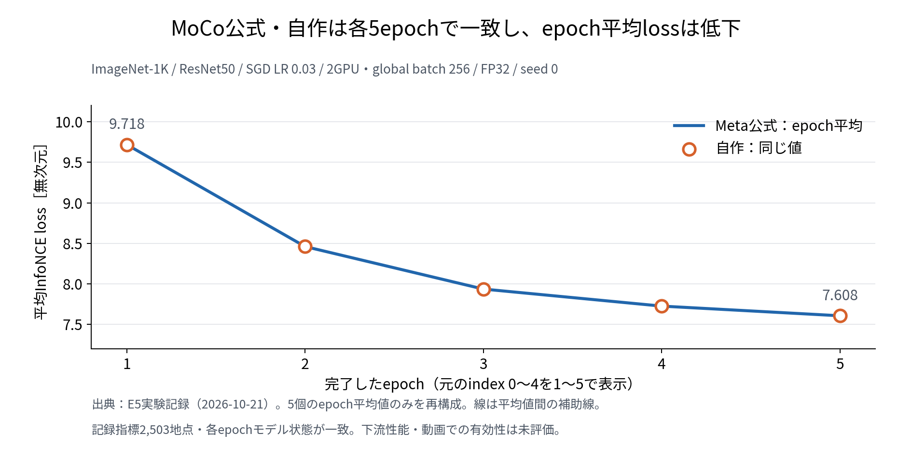
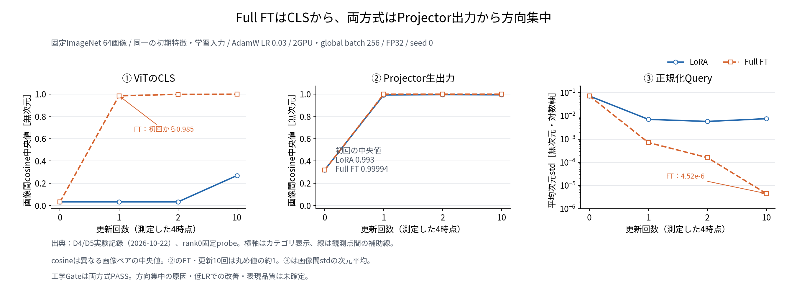

# MTG資料：MoCoの公式比較からViT＋LoRAの診断へ

作成・情報確認日：2026-10-22。前回MTG（2026-10-15）以降の進捗を対象とする。今回のMTG開催日は未指定。

## 0. 今回のMTGで先生に相談したいこと（Ask）

1. **MoCo単体の数値再現性については5epoch比較を一区切りとし、ViTの学習条件の切り分けを優先してよいか。** 記録指標・各epochのモデル状態は公式実装と一致したが、表現品質は別の評価が必要である。
2. **次は学習率だけを下げた短時間対照を先に行う方針でよいか。** Full FT／LoRAともProjector出力が最初の更新で同方向へ集中している。まず共通LRの影響を調べ、その後にBackbone／Projector別の条件を検討したい。
3. **10月30日の中間発表では、現在の検証結果とLoRA解析計画をどう配分するか。** 動画での動的情報獲得は未確認であり、研究目的・解析方法・現在の障害を明確に示したい。

## 1. 現時点の結論

**前回の「部品を一つずつ確かめてから統合する」方針に沿って、ResNetによるMoCoの公式比較を終え、ViTのFull FT／LoRAを同条件で比較できる段階まで進んだ。**

- **MoCo単体：** ImageNet-1Kで公式・自作を各5epoch学習し、記録指標と各epochのcanonical model stateが一致した。epoch平均lossは9.718から7.608へ低下した。
- **ViT接続：** Full FT／LoRAとも2GPU・10stepの工学チェックを通過した。一方、固定画像で測ると、Full FTはViTのCLSから、LoRAもProjector出力から特徴方向の強い集中が見られた。
- **次の課題：** AdamWの初期LR 0.03による大きな初回更新が原因候補である。LRを変更して比較する機能は実装・CPU検証済みだが、低LRの実GPU対照は未実施であり、原因はまだ確定していない。

ここでの「工学チェック通過」は、計算の有限性・更新対象・rank間整合・メモリなどの確認を指す。有用な特徴を学習できたこととは分けて扱う。

## 2. 前回MTGで決めたことと対応状況

| 前回の方針・課題 | 今回までの対応 | 残ること |
| --- | --- | --- |
| MoCoの標準条件・参照実装を確認 | Meta公式モデルと自作実装を共通条件で比較。実ImageNetの各5epochまで一致を確認 | 表現品質の評価 |
| 短い500stepだけで判断しない | 各25,020stepを実行し、epoch平均lossの低下を確認 | loss低下と識別性能の関係 |
| ResNet → ViT → LoRAの順に接続 | ViT Full FT／Frozen ViT＋LoRAの切替、CPU検証、両方式のGPU 10step診断まで実施 | 特徴方向の集中を抑える学習条件 |
| 学習率の高低を比較 | 任意の正の有限LRを指定する診断機能と同方式・異LRの比較を実装。CPU検証済み | 実ViTでの低LR対照。探索完了とは扱わない |
| 最後にSequential Loaderを導入 | ActivityNetの単一フレームmanifestを準備（10,024動画・117,522枚、実decode 64/64） | 今回のViT経路でのActivityNet学習、逐次入力への再統合、stride比較 |
| メモリ・計算量を再確認 | ViT両方式の実GPUピーク使用量と余裕を測定 | 動画統合後の資源見積もり |
| 中間発表の構成とLoRA解析案 | 10/21に研究ストーリー・構成案・解析候補を資料化 | 最新結果の反映と構成レビュー。現行スライドの完成状態は未確認 |

LoRA単体のCIFAR-10分類20stepでのloss低下・Base凍結・LoRA更新は、前回MTG時点で確認済みの土台である。今回の新しい進捗は、MoCoの公式比較とViTへの再接続・診断である。

## 3. Evidence：MoCoは公式実装とどこまで一致したか

### 比較条件

ImageNet-1K train、ResNet50＋MLP、2GPU×local batch 128＝global batch 256、Queue 65,536、EMA momentum 0.999、temperature 0.2。SGD（LR 0.03、momentum 0.9、weight decay 1e-4）、5epochのcosine schedule、seed 0、FP32。同じ初期状態から公式→自作を順番にfresh実行した。

これは共通比較runner上でMeta公式モデルと自作モデルを比べた結果であり、公開200epoch学習の全設定・性能を再現したという意味ではない。

### 結果

| 確認対象 | 5epoch比較の結果 |
| --- | --- |
| 学習完了 | 両実装とも25,020step、5epoch完了。最終サマリーPASS |
| 記録指標 | 共通ログ2,503地点でbitwise一致（ビット単位で一致） |
| 入力 | 採取した入力ハッシュ251/251地点で一致 |
| モデル状態 | 各epoch末のcanonical model state SHAが一致 |
| 記録・所要時間 | 独立したComet実験2件、報告された送信errorsは空。比較全体で11時間11分28秒 |

**この図で見る点：** 公式・自作は同じepoch平均lossを示し、平均値は5epochにわたり低下した。短い初期区間のloss上昇だけでは、後の学習挙動を判断できなかった。



図はE5実験記録にあるepoch平均値5点からの再構成。全stepの曲線ではない。平均lossは9.71783674 → 7.60787190（初回比約21.7%低下）。

**この結果で言える範囲：** 採用条件における自作MoCoの数値再現性には根拠が得られた。すべてのstepの全入力・中間状態やoptimizer／RNG状態の一致、Linear Probe精度、動画での有効性はこの比較の判定範囲に含まれない。

## 4. Evidence：ViT Full FT／LoRAの比較基盤と資源

### 何を比較したか

共通の事前学習済み`google/vit-base-patch16-224`から開始し、CLS 768次元 → Projector（768→768→128）→ L2正規化Queryの経路を使う。

| 方式 | 更新するQuery側パラメータ |
| --- | --- |
| Full FT | ViT本体とProjector |
| LoRA | Q/Vの24箇所に付けたLoRA A/BとProjector。ViT Baseは固定。rank 8、alpha 8、dropout 0 |

ImageNet画像、2GPU×128、FP32、Queue 65,536、AdamW LR 0.03、weight decay 1e-4、LR warmupなし。cosineは5epochを総期間とするepoch単位で、10stepに合わせて圧縮していない。**ResNet比較のSGDからAdamWへOptimizerが変わっているため、同じLR値が同じ更新挙動を意味するわけではない。**

CPUでは実checkpointへの注入・初期CLS一致、DDP同期、更新対象、Base凍結、EMA、保存復元を確認した。実GPUでは両方式とも10stepの工学Gateを通過し、全10stepの学習入力、固定probeの入力、更新前のCLS／Projector／Query特徴が一致した。

| GPU診断（各rank） | LoRA | Full FT |
| --- | ---: | ---: |
| peak reserved [MiB] | 12,338 | 18,346 |
| headroom [MiB] | 7,757.875 | 1,749.875 |
| 工学Gate | PASS | PASS |

採用したheadroomの下限は1,024 MiB。Full FTは下限に対して725.875 MiBの余裕であり、動画統合や条件拡大の資源適合は別途確認が必要である。

## 5. Evidence：特徴の方向集中はどの段階で起きたか

学習中のバッチだけでは入力画像の違いが混ざるため、**同じImageNet画像64枚**を更新前0回・更新後1/2/10回に固定の前処理・evalモードで測った。以下はrank0の固定probeの値である。学習バッチ側の更新前forward指標とは区別する。

```text
ViTのCLS特徴 → Projectorの生出力 z_q → L2正規化したQuery q
     768次元              128次元                 128次元
```

「画像間cosine中央値」は異なる画像ペアの特徴方向の類似度で、1に近いほど同方向に集中している。「平均次元std」は各次元について64画像間の標準偏差を求め、その平均を取ったもの。

| 観測量 | 共通の初期値 | LoRA：更新1回 → 10回 | Full FT：更新1回 → 10回 |
| --- | ---: | ---: | ---: |
| CLSの画像間cosine中央値 | 0.03194 | 0.03192 → 0.26870 | 0.98495 → 0.99999748 |
| Projector生出力の画像間cosine中央値 | 0.31879 | 0.99317 → 0.99406 | 0.99994166 → 約1 |
| 正規化Queryの平均次元std | 0.07263 | 0.007153 → 0.007643 | 0.0007149 → 4.518e-6 |

**この図で見る点：** Full FTは最初の更新でCLSから方向が集中する。LoRAは初期2回の更新ではCLSの分布を概ね保つが、Projector出力では両方式とも強く方向が集中する。



図はD4/D5実験記録の観測点からの再構成。横軸は測定した更新回数のカテゴリであり、点を結ぶ線は観測間の挙動を示すものではない。Projector生出力と正規化後Queryの画像間cosineは同じである。

### 初回更新量から分かること

- Projectorの初回更新ノルムは両方式とも約24.90、更新前パラメータノルムに対する比は約1.44だった。
- Full FTのViT本体は初回更新ノルム約277.44、相対更新約0.360だった。
- Projector生出力のノルム中央値は、初期2.266から更新1回後にLoRA 153.14／Full FT 155.82へ増えた。方向集中は、出力がゼロになった現象とは異なる。
- LoRA Bはゼロ初期化されるため、初回の「相対更新」は分母がほぼゼロになる。方式間の更新倍率比較には使わない。

## 6. Interpretation：原因候補と次に比較したいこと

**最初に検証したい仮説は、AdamW LR 0.03による初回更新が大きすぎ、特徴方向の集中に寄与したというもの。** 両方式でProjector更新が大きく、Full FTではViT本体も大きく変わったことと整合する。ただし低LR対照がないため、現時点では仮説である。

LoRAでも正規化前のProjector出力で方向集中が見られるため、L2正規化だけでは説明できない。一方、各stepで複数の部品を同時に更新しており、Projectorだけ、ViTだけ、LRだけを唯一の原因と断定できない。EMA Key／Queue／InfoNCEとの相互作用も未分離である。

| 方針候補 | 確認したいこと | 現在の位置づけ |
| --- | --- | --- |
| 共通LRだけを下げる | 初回更新とCLS／Projectorの方向集中がどれだけ変わるか | **最初の比較として相談したい**。例：3e-4。値は未採用 |
| Backbone／ProjectorでLRを分ける | 各部品の更新が現象に与える寄与 | 共通LR比較の後に検討する候補。今回の実装対象外 |
| 学習を延長し、表現評価へ進む | 長時間安定性と識別性能 | まず短時間の方向集中を診断し、進める条件を決めたい |

### 学習率対照の準備状況

任意の正の有限LRを指定できる専用診断設定と、**同じ方式の0.03対新LR**を比べる機能を実装済み。CPU Gate L0〜L3はPASSし、従来0.03経路の学習結果を変えない回帰確認も行った。これは小型CPU条件の検証であり、実ViTの低LRによる改善を示す結果ではない。

最新記録では研究コードは未commit、低LRの2GPU診断は未実施。次の実験候補は、他条件を固定してLoRA→Full FTを各10step実行し、保存済み0.03の結果と比較するもの。LRは両方式・全更新対象に同じ値を使い、最初は変更要因を一つにする。

見るべき点は、方向集中の緩和、実際のパラメータ更新量、有限性、入力一致、メモリである。**初期特徴が保たれていても、単に更新が小さすぎるだけなら学習成功とは扱わない。**

## 7. 中間発表とLoRA解析への接続

前回MTGでは、10月30日の中間発表に向け、実験と並行してスライド構成とLoRA解析案を準備する方針だった。10/21の資料には研究ストーリー・構成案が記録されている。PowerPointの現行版や共有先への反映・完成状態は今回確認していない。

発表では、**「動画を逐次学習するLoRAに何が加わるかを解析したい」という目的 → そのために必要な学習基盤 → 今回確認できた再現性と課題 → 今後の解析**の順に説明する案を相談したい。今回のMoCo 5epoch比較とViT診断を、最新の進捗として使える。

| 解析候補 | 研究上の問い・注意点 |
| --- | --- |
| Base対学習済みLoRAの特徴・層別変化 | どこにどの程度の変化が加わったか。変化だけでは動的情報の証拠にならない |
| LoRA更新のSVD・effective rank | 更新の集中や広がりを調べる。特異値だけで意味的な静的／動的分離を判断しない |
| 順逆再生・static-repeat・背景変更などの対照 | 時間順序・動き・静的な見た目のどれに依存するか。まず評価対象と対照条件を絞る |

旧動画構成のframe-wise CLS＋masked meanは、固定パラメータのもとでフレーム順序に不変である。逐次入力による重み更新の順序依存性と、clip特徴が時間順序を直接表すことを区別して説明する。上記は解析候補であり、実施済みの結果ではない。

## 8. 今回言えること／まだ言えないこと

| 今回言えること | まだ言えないこと |
| --- | --- |
| ResNet MoCoの公式・自作比較が、採用条件の5epochで一致した | 公式の長期学習と同等の表現品質を得た |
| ViT Full FT／LoRAは同条件のGPU 10stepを工学的に完了した | どちらが下流性能・動的情報獲得で優れるか |
| 固定probeで、Full FTのCLSと両方式のProjector出力に強い方向集中がある | LR 0.03が唯一の原因で、低LRなら解決する |
| LoRA CLSは初期2回の更新では分布を概ね維持した | LoRAならCollapseを防げる。10回後も初期表現を維持する |
| 低LR対照を行うための機能・CPU検証は整った | 実GPUで低LRの有効性を確認済み |
| 動画学習とLoRA解析に戻るための課題が絞れた | 動画の時間情報獲得、静的／動的情報の分離が成立した |

### MTG後に決めたい順序（候補）

1. 共通低LRの候補値を決め、既存0.03と同条件の短時間対照で特徴軌跡・更新量を比べる。
2. 結果に応じて、部品別LRなどの追加切り分けか、学習期間の延長・軽量表現評価かを選ぶ。
3. 学習条件と表現評価の進め方を定めた後、ActivityNet単一フレーム→Sequential Loaderへ段階的に再統合する。
4. 並行して中間発表の構成をレビューし、解析対象・対照条件を絞る。

## 9. 参照ファイル・図の出典

本資料はResearch Workspaceの既存記録を再構成した。GPU結果は各実験記録に収録されたユーザー提示のサーバ出力・サマリーに基づく。今回、新しい学習・コード検証・Cometの閲覧は行っていない。

- [前回MTG：2026-10-15](../meetings/2026-10-15-mtg.md)：段階的再統合、参照条件確認、中間発表の方針。
- [プロジェクトREADME](../README.md)：全体状況、CPU検証・ActivityNet manifestを含む進捗。
- [MoCo公式／自作の5epoch比較（E5）](../experiments/2026-10-21-meta-moco-v2-e5-imagenet-5epoch-pair-parity-evidence.md)：5epochの数値と判定。図1の出典。
- [ViT Query CollapseのD4/D5結果](../experiments/2026-10-22-vit-moco-query-collapse-d4-imagenet-gpu-diagnostic-evidence.md)：末尾の「D4両方式工学PASSとD5記述的解析」を採用。資源・特徴・更新量、図2の出典。
- [任意LR指定の実装・CPU検証](../experiments/2026-10-22-vit-moco-configurable-lr-implementation-cpu-verification.md)：実装済み／GPU未実施の境界。
- [ViT Full FT／LoRA切替spec](../specs/2026-10-21-vit-ddp-moco-full-ft-lora-switch-smoke-spec.md)：最終採用の構成・条件。
- [Query Collapse診断spec](../specs/2026-10-22-vit-moco-query-collapse-diagnostic-spec.md)：固定64画像、測定時点、指標の定義。
- [可変LR対照spec](../specs/2026-10-22-vit-moco-configurable-learning-rate-collapse-control-spec.md)：末尾の実装記録を採用。
- [10/21研究発表ストーリー・構成案](2026-10-21-online-video-lora-contrastive-research-presentation-mtg-materials.md)：研究目的・解析候補。5epochの実施状況は本資料では上記E5結果に更新している。
- [図のmanifest](figures/2026-10-22-post-mtg-progress-and-vit-moco-diagnosis/manifest.md)：再構成図の元データ・測定条件・制約。
