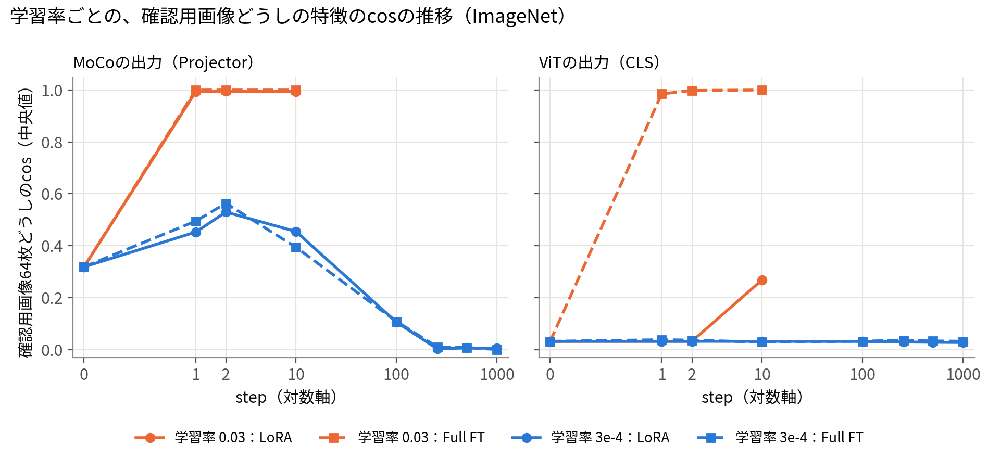
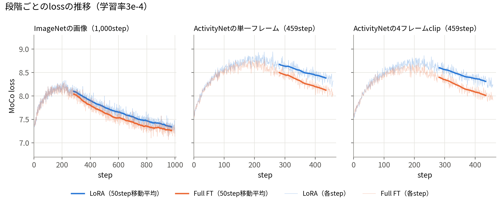
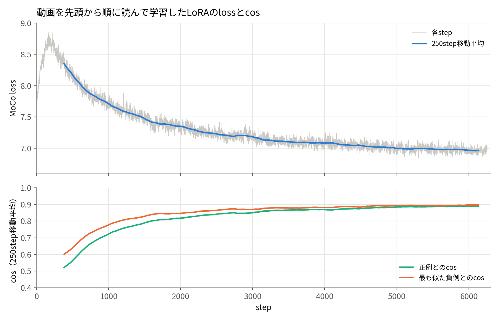
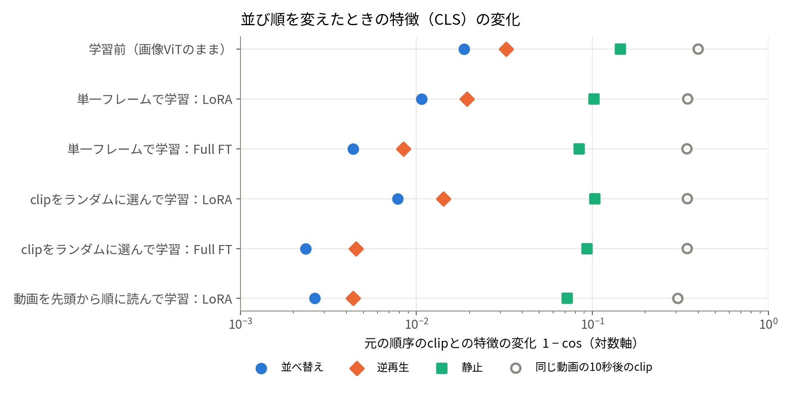

# 2026-11-12 MTG資料：10/22以降の進捗と、次の方針の相談

## 0. 今日のMTGで先生に相談したいこと

1. **学習の目的を変えるべきか**：今のMoCo（同じclipに2種類のデータ拡張をかけたものを正例にする）で、動画を先頭から順に読んで長く学習しました。しかし、**フレームの並び順を区別する情報が身についたという結果は得られませんでした**。次は「時間を見ないと解けない学習の目的」（例：逆再生や並べ替えをしたclipを負例にする）に進むべきか、今の学習のままLoRAの解析に進むべきか、ご意見をいただきたいです。
2. **解析計画の進め方**：中間発表では、Kineticsでの「順再生か逆再生かの判定」など4つの確かめ方を計画しました（2章）。今回は、その手前の簡単な確認（ActivityNetで、逆再生したときに特徴がどれだけ変わるか）だけを行いました。計画どおりKineticsでの評価へ進むか、学習の目的を先に見直すか、順序を相談したいです。
3. **stride比較（10/22で候補に挙がった64／32／16／8）の扱い**：stride 16の1本（6,255step）の学習に約22時間かかりました。今の学習の目的のまま比較を始めるか、目的を決めてから比較するかを相談したいです。

## 1. 前回MTG（10/22）で決めたことの対応状況

### 決定事項

| 決定事項（10/22議事録） | 状況 | 内容 |
|---|---|---|
| 静的・動的情報の分離の先行研究から、自分の研究の位置づけを説明する | 済 | 先輩方の研究を読み、中間発表の背景をこの流れで組み直した |
| 動画生成は応用先の一つとし、自分の範囲を明確にする | 済 | 中間発表の構成に反映した |
| 自分の研究の中心を示す全体構成図を作る | 済 | 中間発表用に作成した（入力 → 固定した画像ViT＋LoRA → ΔWの解析） |
| **まず事前学習の経路を成立させる** | **済（工学的に）** | ActivityNetの動画を先頭から順に読む学習まで、最後まで正常に動いた（4章） |
| その後、strideなどの条件でLoRAがどう変わるかを解析する | **未着手** | stride 16の1本だけ学習した。比較とLoRAの解析はまだ |
| 中間発表に、未実施の実験設定・解析計画・未決事項を書く | 済 | 4つの確かめ方を計画として示した（2章） |

### 次やること（10/22議事録の6件）

| # | 内容 | 状況 |
|---|---|---|
| 1 | 先輩方の研究を調べ、背景・関連研究としてスライドを修正 | 済 |
| 2 | 全体構成図を描く | 済 |
| 3 | ViT＋MoCo／LoRAの未解決点を整理し、事前学習の経路を確認 | 済（4章） |
| 4 | stride比較でLoRAの何を調べるかを明文化。LoRA rankと学習量の数え方も整理 | 一部：解析計画は2章のとおり整理した。学習量は「1 step＝256 clip×4フレーム」で数え、6,255step＝約640万フレーム（公式MoCoと比較したときの5epoch分）にそろえた。LoRA rankは8で実施した（比較はしていない）。**strideの比較条件は未定** |
| 5 | 取得済み結果と計画を区別して中間発表スライドへ反映 | 済 |
| 6 | 高間さんにスライド確認を依頼し、スライド確認の日程を確定 | 10/29にスライド確認を実施。高間さんへの依頼は（未記録・要確認） |

## 2. 中間発表の解析計画に対して、できたこと・できていないこと

中間発表では「時系列順に学習したLoRA（ΔW）は動的情報を獲得したか」を、次の4つで確かめる計画を示しました。

| 確かめ方（中間発表の計画） | 状況 |
|---|---|
| ① 時間の構造だけを壊す：Kineticsの動画で、順再生か逆再生かを線形分類器で当てる。ΔWを足すと正答率が上がるかを見る | **未実施**。手前の確認として、ActivityNetで「逆再生したときの特徴の変化量」だけを測った（5章） |
| ② 見た目だけを変える：スタイル変換した動画と逆再生した動画で、特徴の変化量を比べる | 未実施 |
| ③ ΔWの中身を分ける：特異値分解し、単一フレームで学習したLoRAと共通の成分と、それ以外の成分に分ける | 未実施（比べるLoRAは学習済み） |
| ④ 動きが必要な課題で試す：Kineticsで動作認識の線形分類 | 未実施（目的も保留中） |

比べるLoRAの準備状況：

| 中間発表で比べる予定だったもの | 状況 |
|---|---|
| 学習前（画像ViTのまま、ΔW＝0） | あり |
| フレーム単位のLoRA（静的な対照） | あり：ActivityNetの単一フレームで459step学習 |
| 時系列順に学習したLoRA（提案） | あり：ActivityNetの動画を先頭から順に読み、stride 16で6,255step学習。**ただし、フレーム単位のLoRAとは学習量が違う**（459step） |
| 参考：clipを動画のランダムな位置から取り出して学習したLoRA（clip内のフレームは時間順） | あり：459step |

**中間発表の計画で立てた仮説は「ΔWを足すと、逆再生への反応が学習前より大きくなり、時系列順のLoRAで最も大きい」でした。今回の簡単な確認では、反対の傾向（学習すると逆再生への反応が小さくなる）が出ました（5章）。**

## 3. 現時点の結論

- **事前学習の経路は、工学的には成立しました。** ImageNet → ActivityNetの単一フレーム → ActivityNetの4フレームclip → 動画を先頭から順に読む学習、と段階的に入力を差し替えました。どの段階でも学習が最後まで正常に進み、lossが下がり、特徴が1方向に潰れる現象（collapse）は見られませんでした。
- **しかし、並び順の情報は入っていません。** 学習したモデルはどれも、学習前より並び順の変化に鈍くなりました。動画を先頭から順に読んで長く学習したLoRAが最も鈍く、同じ動画の中で時間が変わっても似た特徴を出す方向（時間に対して不変な特徴）に近づいていました。
- 今の学習の目的は、見た目（背景・物体）だけで解けてしまいます。**時間情報をLoRAに入れるには、学習の目的を変える必要がある**、というのが現時点の見立てです（仮説）。

## 4. 結果①：事前学習の経路（10/22以降）

| 日付 | 段階 | 結果 |
|---|---|---|
| 10/31〜11/01 | ImageNet、学習率を0.03から3e-4に下げる | 10/22に報告した「初回の更新直後に特徴が1方向に集まる」現象が消えた。1,000stepでもcollapseなし |
| 11/01〜03 | ActivityNetの単一フレーム（459step） | LoRA・Full FTとも最後まで正常、lossは減少 |
| 11/03 | ActivityNetの4フレームclip（0.25秒間隔、459step） | LoRA・Full FTとも最後まで正常、lossは減少 |
| 11/04〜09 | 動画を先頭から順に読む学習（stride 16、6,255step、LoRA） | 最後まで正常、lossは8.35→6.96（途中のエラーを直して再実行） |
| 11/11 | 研究コードの整理（入口と設定を1つにまとめた） | 計算は変えていない（整理前の結果と完全に一致） |

### 学習率を下げて、特徴が1方向に集まる現象（collapse）が消えた

**図の内容**

- ImageNetで学習したときに、特徴が1方向に集まっていないかを確かめた図です。ImageNet trainから固定した64枚の画像（確認用画像）を、決まったstepでモデルに通し、64枚の特徴どうしのcos類似度（2,016組）の中央値を描いています。
  - cosが1に近いほど、違う画像なのに同じ向きの特徴になっている（collapseしている）ことを表します。
  - 学習前の値は、MoCoの出力で0.32、ViTの出力で0.03です。
- 左はMoCoの出力（Projectorの出力）、右はViTの出力（CLS）です。
- 横軸はstep（パラメータの更新回数）です。0は学習前を表します。1・2・10stepの変化と1,000stepまでの変化を1枚に収めるため、対数軸にしています。
- 色は学習率（橙：0.03、青：3e-4）、線の種類は学習方式（実線：LoRA、破線：Full FT）です。
- 学習率0.03の実験は10stepまで（10/22に報告した実験）、3e-4の実験は1,000stepまでです。どちらも2 GPU、1 seedです。

**読み取れること**

- 学習率0.03では、LoRA・Full FTとも、**1回目の更新でMoCoの出力のcosがほぼ1になりました**。Full FTでは、ViTの出力（CLS）も1回目の更新で0.985になりました。LoRAのViTの出力は2stepまで変わりませんでしたが、10step目には0.27まで上がり始めていました。
- 学習率3e-4では、MoCoの出力のcosは2stepで0.5台まで上がった後に下がり、1,000stepではほぼ0になりました。ViTの出力は、両方式とも学習前の0.03付近のままでした。
- 1回目の更新での勾配は、学習率によらず同じでした。違ったのは更新量で、1/100になりました。Adamの最初の更新は、各パラメータをほぼ学習率の大きさだけ動かします。学習率0.03は、その1回で特徴を1方向に寄せてしまうほど大きかった、という説明と合っています。
- 注意：2つの学習率の実験では、使ったGPUの1枚が違います。そのため厳密な比較ではありませんが、差は桁違いに大きいです。

### ImageNet → ActivityNetの単一フレーム → 4フレームclip

**図の内容**

- 入力を段階的に差し替えたときの、MoCoのlossの推移です。学習率はすべて3e-4です。
  - 左：ImageNetの画像（1,000step）
  - 中：ActivityNetの単一フレーム（459step）
  - 右：ActivityNetの4フレームclip（0.25秒間隔、459step）
- 459stepは、ActivityNetの10秒ごとのフレーム117,522枚を1周する量です。
- 青がLoRA、橙がFull FTです。薄い線は各stepの値、濃い線は50stepの移動平均です。
- 移動平均は、step 257以降だけで計算しています。MoCoは過去のbatchの特徴を負例として待ち行列（Queue、65,536個）にためます。step 256までは、初期値（ランダム）がまだ残っているためです。

**読み取れること**

- どの段階でも、step 256まではlossが上がり、その後は下がり続けました。
  - 前半に上がるのは、待ち行列のランダムな初期値が、実際の画像の特徴に置き換わっていく途中だからだと考えています。実際の特徴のほうが、正例と見分けにくい負例になるためです。
  - 待ち行列が実際の特徴で埋まった後に下がり続けることを、学習が進んでいる目安にしました。
- LoRA・Full FTのどちらでも同じ傾向でした。
- どの段階でも、特徴が1方向に集まる現象は見られませんでした。上の図と同じ確認用画像で確かめています。

| 段階 | 方式 | loss（待ち行列が埋まった直後 → 最後） |
|---|---|---|
| ImageNetの画像（1,000step） | LoRA | 8.06 → 7.37 |
| | Full FT | 7.99 → 7.28 |
| ActivityNetの単一フレーム（459step） | LoRA | 8.67 → 8.38 |
| | Full FT | 8.50 → 8.12 |
| ActivityNetの4フレームclip（459step） | LoRA | 8.60 → 8.31 |
| | Full FT | 8.40 → 8.01 |

- 表の値は平均です。ImageNetは最初と最後の100step、ActivityNetは最初と最後の50stepで平均しました。
- Full FTのほうがlossは低いですが、1 seedの結果なので、どちらが優れているかは言えません。

**入力の作り方の変更（共有）**：clipの入力を、フレームごとにViTに通して平均する方式（late fusion）から、**4フレームのtokenを1つの系列にしてViTへ同時に入れる方式（early fusion、785 token）**に切り替えました。平均する方式では、LoRAが付いたattentionが1フレームの中しか見ないため、LoRAがフレーム間の関係を表す場所がありません。フレームの順番は、学習しない固定のsin-cosの時間位置埋め込みで与えています（学習するパラメータは増やしていません）。9/24 MTGで「どちらが適切かは評価で判断」としていた点です。

### 動画を先頭から順に読む学習の設定と推移

**設定**：ActivityNet trainingを使いました。

- 1 GPUあたり128本の動画を同時に先頭から読みます。stride 16フレーム（30 fpsで約0.53秒間隔）で取った4フレームを1 clipとし、1 stepに1 clipずつ進めます。
- 2 GPUで、1 stepあたり256 clipです。
- LoRA（attentionのQ・V、rank 8）、学習率3e-4、6,255step（約640万フレーム）です。

**図の内容**

- 上の段はMoCoのlossです。灰色の細い線は各stepの値、青い線は250stepの移動平均です（step 257以降だけで計算）。
- 下の段は、学習batchの中で測ったcos類似度です（250stepの移動平均）。
  - 緑：clipの特徴と、正例（同じclipに別のデータ拡張をかけたもの）の特徴とのcos
  - 橙：待ち行列の負例の中で、最も似ているものとのcos
- 横軸はstepです。step 2,000で一度止め、そのときの保存点から再開しました。step 1〜2,000と2,001〜6,255は、2回の実行の記録をつないでいます。再開直後の入力とlossは、止める前の実行と一致しました。

**読み取れること**

- lossは、待ち行列が埋まった後、8.35（step 257〜506の平均）から6.96（最後の250stepの平均）まで下がりました。下がり方は後半ほど小さく、step 4,000以降はほぼ横ばいです。
- 正例とのcosは0.52から0.89まで上がりました。一方で、**最も似た負例とのcosは、全期間で正例とのcosをわずかに上回りました**（最後の250stepで0.896と0.889）。
  - 動画を順に読むと、待ち行列には同じ動画の少し前のclipが入ります。最も似た負例は、それだと考えられます（未確認）。
- 学習batchの特徴のばらつきは最後まで保たれていて、collapseは見られませんでした。

| step（250stepの平均） | loss | 正例とのcos | 最も似た負例とのcos |
|---|---|---|---|
| 257〜506 | 8.348 | 0.522 | 0.601 |
| 3,007〜3,256 | 7.140 | 0.858 | 0.874 |
| 6,006〜6,255 | 6.964 | 0.889 | 0.896 |

- 1 stepの計算は約8.9秒、データの読み込み待ちは約3秒でした。

## 5. 結果②：並び順を変えたときの特徴の変化

**測り方**：ActivityNet validation（学習に使っていない動画）から2,000 clipを選びました（4フレーム、0.25秒間隔）。元の順序（1→2→3→4）のclipの特徴（最終層のCLS）と、次のように変えたclipの特徴とのcos類似度を測りました。ラベルは使っていません。

- 並べ替え：ランダムな順序（clipごとに1つ選ぶ）
- 逆再生：4→3→2→1
- 静止：最後のフレームを4回繰り返す（動きがなくなる）
- 同じ動画の10秒後のclip：内容が変わったときの変化の大きさの目安

**図の内容**

- 横軸は、元の順序のclipとの特徴の変化の大きさ（1 − cos）です。2,000 clipの平均です。
  - 0に近いほど、変えても特徴が変わらないことを表します。
  - 値の幅が0.002〜0.4と広いので、対数軸にしています。
- 縦軸はモデルです。上から順に次の6つです。
  - 学習前（画像ViTのまま）
  - 単一フレームで学習（LoRA、Full FT）
  - clipを動画のランダムな位置から取り出して学習（LoRA、Full FT。clipの中のフレームは時間順）
  - 動画を先頭から順に読んで学習（LoRA）
- 印の種類が変え方を表します：青丸＝並べ替え、橙の菱形＝逆再生、緑の四角＝静止、灰色の白丸＝同じ動画の10秒後のclip。
- 95%信頼区間（同じclipどうしで比べるbootstrap）は、どの点も印より小さいため描いていません。

**読み取れること**

- **並べ替え・逆再生による変化は、内容が変わったとき（同じ動画の10秒後）より1〜2桁小さい**です。逆再生の1 − cosは、学習前で0.032、10秒後のclipでは約0.3〜0.4です。
- **学習すると、並べ替え・逆再生による変化はさらに小さくなりました。** 逆再生の1 − cosは、学習前の0.032から次のように小さくなりました。
  - 単一フレームで学習：0.019（LoRA）
  - clipをランダムに選んで学習：0.014（LoRA）
  - 動画を先頭から順に読んで学習：0.004（6つの中で最小）
- 静止による変化は、並べ替え・逆再生より大きいです（0.07〜0.14）。ただし、これには動きがなくなったことと、3枚のフレームの見た目が消えたことの両方が混ざっています。
- 動画を先頭から順に読んで学習したLoRAは、静止に対しても最も鈍いです。一方で、同じ動画の10秒後のclipとは最も近くなりました。

元の順序とのcos（LoRAのモデル、2,000 clipの平均。1に近いほど変化が小さい）：

| モデル | 並べ替え | 逆再生 | 静止 | 同じ動画の10秒後 |
|---|---|---|---|---|
| 学習前（画像ViTのまま） | 0.981 | 0.968 | 0.856 | 0.600 |
| 単一フレームで学習 | 0.989 | 0.981 | 0.898 | 0.652 |
| clipをランダムに選んで学習 | 0.992 | 0.986 | 0.897 | 0.653 |
| 動画を先頭から順に読んで学習 | 0.997 | 0.996 | 0.928 | 0.694 |

- Full FTのモデルも同じ傾向でした（図を参照）。
- 「順に読んで学習」と「clipをランダムに選んで学習」の差は、4つの条件すべてで95%区間が0をまたぎません。
- 別の動画のclipとの類似度は、「順に読んで学習」でほぼ0になりました（MoCoの出力で0.008）。

## 6. 解釈：なぜ並び順の情報が入らないのか

1. **学習の目的が見た目だけで解ける（支持される解釈）**：正例は「同じclipに2種類のデータ拡張をかけたもの」なので、背景や物体の見た目が一致していれば正解できます。並び順を見る必要がありません。early fusionと時間位置埋め込みで、構造上は時間を扱えるようにしましたが、それを使う必要が生じていません。
2. **順に読む学習では、時間に対して不変な特徴へ近づいた（観測）**：別の動画との区別は進んだ一方で、同じ動画の中の時間の変化には鈍くなりました。lossの低下の大部分は、別の動画との区別から来ていると読めます。
3. **「同じ動画の少し前のclipが負例になる」ことの効果は見えなかった（仮説が支持されなかった）**：順に読むと、待ち行列に同じ動画の少し前のclipが入り、それが最も似た負例になります（4章の図の下段）。これが同じ動画の中の違いを見分ける圧力になるかもしれない、と考えていました。しかし、並び順に敏感になる方向の変化は見えませんでした。
4. **「順に読んで学習」と「clipをランダムに選んで学習」の違いは、読み方だけによるものではありません**：学習量（6,255stepと459step）、フレームの間隔（約0.53秒と0.25秒）も同時に違います。

## 7. 今回言えること／まだ言えないこと

**言えること**

- 画像ViT＋LoRA＋MoCo（early fusion）の事前学習は、ActivityNetの動画を先頭から順に読む設定でも、collapseせずにlossが下がるところまで動く。
- 今の学習の目的では、並び順を区別する情報は特徴に現れない。順に読んで長く学習しても同じ。

**まだ言えないこと**

- LoRAが何を獲得したか（静的・動的のどちらか）。中間発表で計画した4つの確かめ方は、まだどれも行っていません。
- 表現の良し悪し（動作認識などの下流タスクの性能）。
- 順に読んだLoRAが鈍くなった原因が、学習量・フレームの間隔・読み方のどれか。
- strideによってLoRAがどう変わるか（stride 16の1本だけ）。
- いずれも1 seedの結果です。

## 8. 次に進む候補

| 候補 | 内容 | 狙い | コスト・懸念 |
|---|---|---|---|
| **学習の目的を変える** | 逆再生・並べ替えをしたclipを負例に加える、など | 「時間を見ないと解けない」状況を作り、LoRAに時間情報が入るかを見る | 設計の選択肢が多い。並べ替えの痕跡など、見た目以外の手がかりで解かれないよう注意が必要 |
| 原因の切り分け | 順に読んだ学習の途中の保存点（1,000〜6,000step）を同じ評価にかける。学習時の間隔（約0.5秒）でも評価する | 鈍くなった原因が学習量か読み方かを分ける | 追加の学習は不要（評価だけで、数十分程度の見込み） |
| 中間発表の解析計画を進める | Kineticsでの順再生・逆再生の判定、ΔWの特異値分解など | 計画どおりにLoRAの中身を確かめる | 今の学習では並び順の情報が入っていないため、否定的な結果になる可能性が高い |
| stride比較 | stride 64／32／16／8で学習し、LoRAの違いを見る | 10/22で決めた「LoRAに何が獲得されるか」を問う | 1本約22時間。学習の目的を決めてからのほうが解釈しやすい |

- 現時点の提案：**原因の切り分けは安いのですぐに行い、本命は学習の目的の変更**です。stride比較と中間発表の解析計画は、学習の目的が決まってから行うほうが、結果を解釈しやすいと考えています（相談したい点）。
- どの候補も、まだ計画書やTODOにはしていません。MTGでの方針を受けて具体化します。

## 9. 参照ファイル

**前回MTG・中間発表の計画**

- [10/22 議事録](../meetings/2026-10-22-mtg.md)
- [解析計画（4つの確かめ方）の壁打ち](../../../../secretary/notes/brainstorm/2026-10-28-dynamic-information-verification-proposals.md)・[Kineticsでの方法と10/29のスライド確認での指摘](../../../../secretary/notes/brainstorm/2026-10-29-case1-case2-verification-design-kinetics.md)
- [全体構成図](figures/2026-10-26-midterm-method-overview/01-method-overview.png)

**実験記録**

- [動画を先頭から順に読む学習（6,255step）](../experiments/2026-11-04-sequential-loader-clip-moco-lora-g2-gpu-evidence.md)
- [並び順の評価：順に読んだLoRAを追加](../experiments/2026-11-11-temporal-order-sensitivity-evaluation-g2-gpu-evidence.md)
- [並び順の評価：学習前・単一フレーム・clipの5モデル](../experiments/2026-11-04-temporal-order-sensitivity-evaluation-r1-gpu-evidence.md)
- clip（4フレーム）の学習：[LoRA](../experiments/2026-11-03-vit-moco-lora-activitynet-clip-a2-lora-gpu-evidence.md)・[Full FT](../experiments/2026-11-03-vit-moco-lora-activitynet-clip-a2-full-ft-gpu-evidence.md)
- 単一フレームの学習：[LoRA](../experiments/2026-11-03-vit-moco-lora-activitynet-a2-lora-gpu-evidence.md)・[Full FT](../experiments/2026-11-03-vit-moco-lora-activitynet-a2-full-ft-gpu-evidence.md)
- 学習率を下げた確認：[10step](../experiments/2026-10-31-vit-moco-low-lr-l4-imagenet-gpu-evidence.md)・[1,000step](../experiments/2026-11-01-vit-moco-low-lr-l5-1000step-imagenet-gpu-evidence.md)
- [研究コードの整理](../experiments/2026-11-11-vit-moco-pipeline-refactoring-implementation-cpu-verification.md)

**計画書・壁打ち**

- [並び順の評価の計画](../specs/2026-11-03-temporal-order-sensitivity-evaluation-spec.md)
- [動画を先頭から順に読む学習の計画](../specs/2026-11-04-sequential-loader-clip-moco-lora-6255step-spec.md)
- [4フレームclip（early fusion）の計画](../specs/2026-11-03-vit-moco-lora-activitynet-clip-early-fusion-spec.md)
- [early fusionへの切り替えの壁打ち](../../../../secretary/notes/brainstorm/2026-11-01-early-fusion-vit-lora-temporal.md)

**図**

- [学習率による確認用画像のcosの推移](../experiments/figures/2026-11-01-imagenet-learning-rate-collapse/01-probe-cosine-by-lr.png)（[manifest](../experiments/figures/2026-11-01-imagenet-learning-rate-collapse/manifest.md)）
- [段階ごとのlossの推移](../experiments/figures/2026-11-03-pretraining-loss-by-stage/01-loss-by-stage.png)（[manifest](../experiments/figures/2026-11-03-pretraining-loss-by-stage/manifest.md)）
- [lossとcosの推移](../experiments/figures/2026-11-09-sequential-loader-lora-loss/01-loss-and-cosine.png)（[manifest](../experiments/figures/2026-11-09-sequential-loader-lora-loss/manifest.md)）
- [並び順を変えたときの変化](../experiments/figures/2026-11-11-temporal-order-sensitivity-sequential-lora/01-order-change-cls.png)（[manifest](../experiments/figures/2026-11-11-temporal-order-sensitivity-sequential-lora/manifest.md)）
- 生成スクリプト：[`make_2026-11-11_mtg_figures.py`](../experiments/figures/make_2026-11-11_mtg_figures.py)（研究リポジトリのログを読むだけ）
