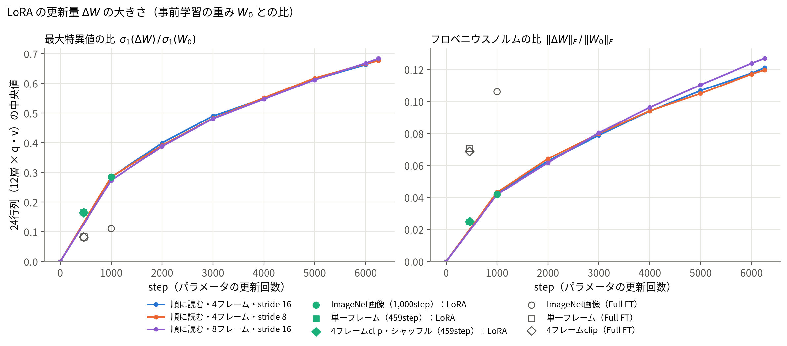
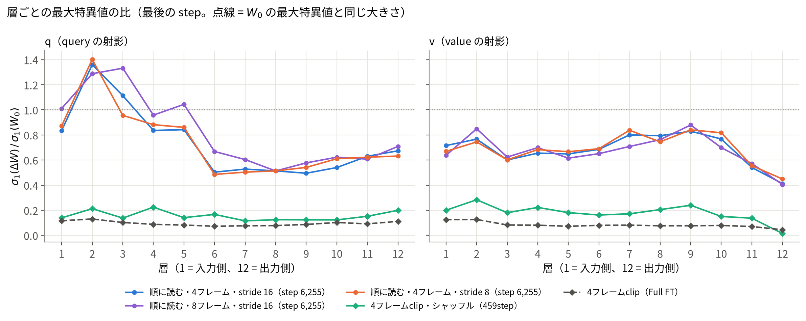
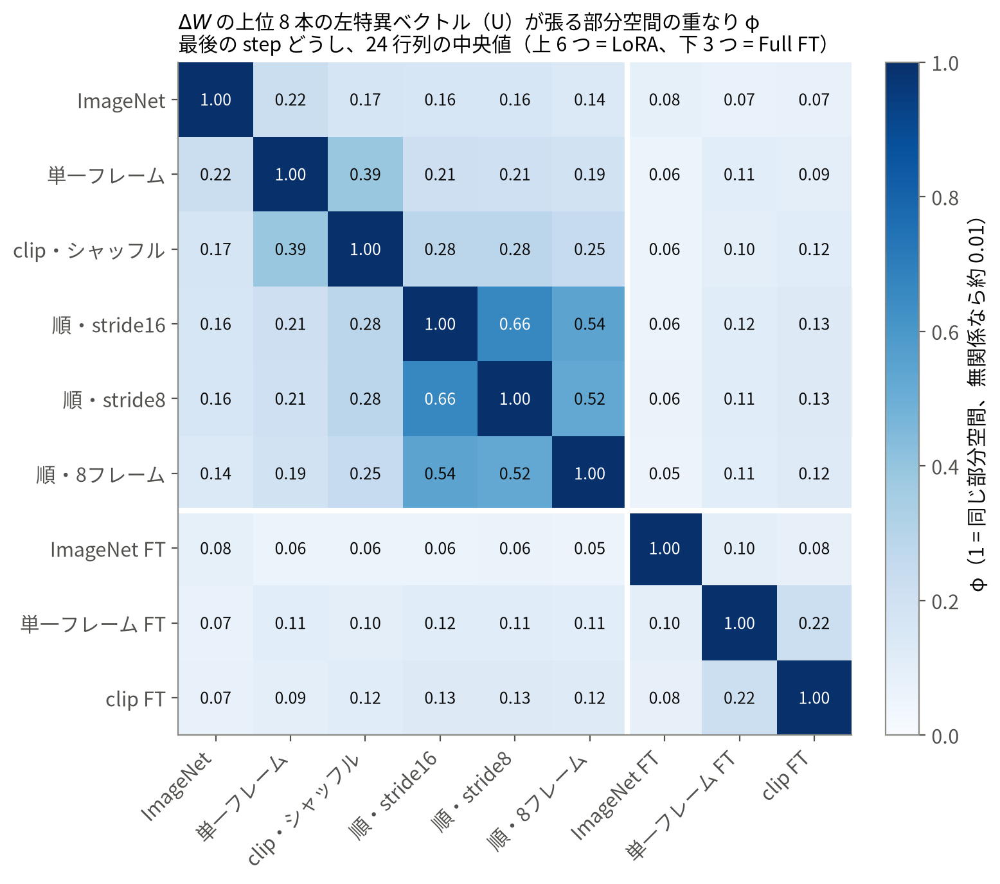

# 2026-11-19 MTG資料: LoRA の特異値分解で見た現状

## 0. 今日のMTGで先生に相談したいこと

前回（11/12）の決定どおり、今の学習済みモデルの LoRA を特異値分解し、事前学習の重みとの比較と、初期値からの距離を数値で出しました。その結果について、次の 3 点を相談したいです。

1. **LoRA は「ほとんど動いていない」わけではなかった。** ただし、動いた大きさはデータに関係なく step 数でほぼ決まっていた。**LoRA の評価軸を「大きさ」ではなく「向き（部分空間）」に移してよいか。**
2. LoRA は動いているのに、並び順への反応は学習前より鈍くなっていた（11/11 の評価）。**この状態を「ベースライン」として、正例・負例の変更に進んでよいか。** それとも先に、LoRA あり／なしで反応する場所の可視化を入れるべきか。
3. 順に読む学習どうしでは、stride やフレーム数を変えても ΔW の向きがかなり似ていた。ただし全 run が同じ seed なので、理由を切り分けられない。**seed だけを変えた再学習（約 20 時間）で基準を作るべきか。**

## 1. 現時点の結論

- **大きさ**：動画を順に読んで 6,255step 学習した LoRA の更新 ΔW は、最大特異値で事前学習の重み W₀ の約 0.68 倍（24 行列の中央値）、フロベニウスノルムで約 12%。初期層の q では W₀ の最大特異値を超える層もある。
- **ただし大きさは step 数でほぼ決まる**：step 1,000 の時点では、ImageNet の画像で学習した LoRA と、動画を順に読んで学習した LoRA 3 本の大きさが、ほぼ同じ（最大特異値の比 0.27〜0.28）。データの違いは大きさにほとんど出ていない。
- **向き**：LoRA の ΔW は 8 本のうち実質 2〜4 本の方向に集中している。W₀ の主要な方向（上位 16 本）はほぼ保たれている。
- **run どうし**：順に読む 3 run どうしは向きがかなり似ている（φ = 0.52〜0.66、無関係なら約 0.01）。シャッフルの clip 学習とは 0.25〜0.28、Full FT とは 0.05〜0.13。
- **現時点の見立て（仮説）**：LoRA は「ほとんど動いていない」のではなく、動いている。ただ、11/11 の評価では並び順の情報は入っていなかったので、動いた先は時間に対して不変な方向（見た目）だと考えている。これは特異値分解だけからは言えず、確かめていない。

## 2. 前回MTGからの流れ

| 前回の決定・次やること | 状態 |
|---|---|
| LoRA を特異値分解し、事前学習の重みとの比較・初期値からの距離で現状を把握する | **実施**。9 run・27 checkpoint を書き出した（3 節） |
| 結果を実験ごとに管理し、層・q/v を選んで表示できるアプリを作る | **実施**。CSV への書き出し＋HTML ビューア。ブラウザでの表示確認は手元でまだ |
| 結果は数値・グラフで出す | この資料（図 3 枚、数値表） |
| 図・Artifact に元の実験記録へのリンクを付ける | ビューアに実験記録名を表示する。Comet の URL は、順に読む 2 run（stride 16・8）だけ登録済みで、残りは空欄 |
| シャッフルと順に読む学習の比較 | 特異値分解の上では比較した（ただし step 数が 459 と 6,255 で違う） |
| 複数の動画を並列に読む場合と読まない場合の比較 | 未実施 |
| 杉野さんに解析とアプリのノウハウを聞く | workspace に記録なし（口頭で補足します） |

あわせて、比較用の学習を 2 本追加した（どちらも工学 PASS、collapse なし）。

| 学習（どれも 6,255step、LoRA、学習率 3e-4） | loss（step 257〜506 → 6,006〜6,255 の平均） | 最後の窓：正例の cos ／ 最も似た負例の cos |
|---|---|---|
| 順に読む・4 フレーム・stride 16（前回報告） | 8.348 → 6.964 | 0.889 ／ 0.896 |
| 順に読む・4 フレーム・**stride 8**（11/16〜17） | 8.412 → 6.998 | 0.887 ／ 0.909 |
| 順に読む・**8 フレーム**・stride 16、GPU 3 枚（11/17〜19） | 8.405 → 6.895 | 0.900 ／ 0.890 |

- 8 フレームは GPU 2 枚に入らないので 3 枚にした。そのため batch は 255、Queue は 65,280 で、ほかの 2 本（256・65,536）と少し違う。学習に入れたフレーム数も約 2 倍。
- 8 フレームの値は、学習ログ（`metrics.jsonl`）から今回集計した。実験記録にはまだ追記していない。

## 3. 何をしたか

- **対象**：学習済み LoRA の q・v（12 層 × 2 = 24 行列、各 768×768）。比べるために Full FT の同じ行列も見た。
- **ΔW**：LoRA は `scaling × B A`（rank 8、scaling 1）。Full FT は `W_FT − W₀`。LoRA の B は 0 で初期化しているので、学習前の ΔW は 0。**つまり ‖ΔW‖_F がそのまま「初期値からの距離」になる。**
- **比べる相手**：事前学習の重み W₀（`google/vit-base-patch16-224`）の特異値。
- **対象の run**：

| 学習 | 方式 | 見た step |
|---|---|---|
| ImageNet 画像 | LoRA・Full FT | 1,000 |
| ActivityNet 単一フレーム（シャッフル） | LoRA・Full FT | 459 |
| ActivityNet 4 フレーム clip（シャッフル） | LoRA・Full FT | 459 |
| 順に読む・4 フレーム・stride 16 | LoRA | 1,000〜6,000（1,000 ごと）、6,255 |
| 順に読む・4 フレーム・stride 8 | LoRA | 同上 |
| 順に読む・8 フレーム・stride 16 | LoRA | 同上 |

- **数値の確認**：書き出しのコードを使わずに checkpoint から計算し直し、7 checkpoint 以上で相対 5e-10 以内で一致した。LoRA の凍結した重みは、事前学習の重みと bitwise に一致した。

## 4. Evidence: 結果

### 4.1 大きさは step 数でほぼ決まる

この図で見る点：線（順に読む 3 run）がほぼ重なっていること。step 1,000 の ImageNet LoRA（緑の丸）も同じ線の上にあること。

| 学習（LoRA） | step | σ₁(ΔW) ÷ σ₁(W₀) | ‖ΔW‖_F ÷ ‖W₀‖_F |
|---|---|---|---|
| 単一フレーム | 459 | 0.166 | 0.025 |
| 4 フレーム clip・シャッフル | 459 | 0.165 | 0.025 |
| ImageNet 画像 | 1,000 | 0.285 | 0.042 |
| 順に読む・stride 16 | 1,000 | 0.284 | 0.043 |
| 順に読む・stride 8 | 1,000 | 0.285 | 0.043 |
| 順に読む・8 フレーム | 1,000 | 0.273 | 0.042 |
| 順に読む・stride 16 | 6,255 | 0.680 | 0.121 |
| 順に読む・stride 8 | 6,255 | 0.676 | 0.120 |
| 順に読む・8 フレーム | 6,255 | 0.684 | 0.127 |

（値は 24 行列の中央値）

- 同じ step 数では、画像か動画か、stride、フレーム数によらず、大きさはほぼ同じ。
- 6,255step でも伸び続けている。1,000step ごとの変化 ‖ΔW_t − ΔW_前‖_F（24 行列まとめて）は、順に読む・stride 16 で 14.8（0〜1,000）から 8.9（5,000〜6,000）へ減っているが、止まってはいない。
- Full FT は、LoRA より最大特異値の比が小さく（459step で約 0.08）、ノルムの比は大きい（約 0.07）。更新が多くの方向に広がっているため。

### 4.2 層ごとの大きさ

この図で見る点：q は入力側の層（1〜5）で大きく、層 2 では W₀ の最大特異値を超える。v は層 12 で小さい。

- 順に読む 3 run の層ごとの形はよく似ている。
- 4 フレーム clip（シャッフル、459step）の LoRA は、全層で 0.12〜0.28（v の層 12 だけ 0.015）。

### 4.3 向き：少ない方向に集中し、W₀ の主要な方向は保たれる

| 学習 | 有効ランク（8 本のうち、中央値） | W₀ の上位 16 本の向きのずれ 1 − φ（中央値 ／ 最大） |
|---|---|---|
| 4 フレーム clip・シャッフル（LoRA、459step） | q 1.7 ／ v 1.9 | 0.001 ／ 0.006 |
| 順に読む・stride 16（LoRA、6,255step） | q 3.2 ／ v 3.8 | 0.07 ／ 0.15 |
| 4 フレーム clip（Full FT、459step） | 上位 32 本のうち約 30 | 0.007 ／ 0.04 |

- 有効ランク = exp(−Σ pᵢ log pᵢ)、pᵢ = σᵢ² ÷ Σσⱼ²。
- 1 − φ は、W₀ の上位 16 本の左特異ベクトルが張る部分空間が、W₀ + ΔW でどれだけ変わったか（0 なら変わらない）。

### 4.4 run どうしで向きは似ているか

この図で見る点：順に読む 3 run どうし（中央の濃い 3×3）が、ほかの組より明らかに高いこと。LoRA と Full FT の組は低いこと。

- φ = ‖Uᵢᵀ Uⱼ‖²_F ÷ 8。ΔW の上位 8 本の左特異ベクトルが張る部分空間の重なり（1 なら同じ、無関係なら約 8 ÷ 768 ≈ 0.01）。
- 順に読む・stride 16 の中で、step 1,000 と step 6,255 の φ は 0.56（中央値）。学習の途中でも向きは変わり続けている。
- 右特異ベクトル（V）でも傾向は同じだが、全 run が同じ seed で LoRA の A の初期値を共有しているので、高めに出る（例：単一フレームと clip・シャッフルで 0.79）。

## 5. Interpretation: 解釈

- **「LoRA はほとんど動いていない」という予想とは違った。**（観測）最大特異値は W₀ の 0.17 倍（459step）〜0.68 倍（6,255step）で、「0.1% 程度」よりずっと大きい。
- **ただし、大きさは「何を学んだか」の指標になっていない。**（支持される解釈）同じ step 数ならデータが違っても大きさがそろうので、大きさは主に「学習率 × 更新回数」で決まっていると考えられる。AdamW は 1 回の更新の大きさをほぼ学習率にそろえるので、この結果と矛盾しない。
- **違いが出るのは向き。**（観測）順に読む学習どうしは向きが似ていて、シャッフルや画像の学習とは違う。
  - 順に読む学習で共通に学ばれた何かがある可能性がある（仮説）。
  - ただし、順に読む 3 run は step 数も同じで、seed も同じ。シャッフルの run は 459step しかない。似ている理由が「順に読むこと」なのか、「長く学習したこと」や「同じ seed」なのかは切り分けられていない。
- **並び順の評価と合わせると**：（相談用の推測）LoRA は大きく動いているのに、並び順への反応は鈍くなった。動いた先は、時間が変わっても同じ特徴を出す方向（見た目）だと考えている。正例・負例を変える理由の裏付けにはなりそうだが、特異値分解だけでは「何の情報か」は言えない。

## 6. 今回言えること / まだ言えないこと

### 言えること

- 学習した LoRA の ΔW は、W₀ の最大特異値に対して 0.17 倍（459step）〜0.68 倍（6,255step）の大きさがあり、無視できる大きさではない。
- その大きさは、同じ step 数ならデータ・stride・フレーム数によらずほぼ同じ。
- LoRA の ΔW は少数（2〜4 本程度）の方向に集中し、W₀ の主要な 16 方向はほぼ保たれる。
- 順に読む 3 run どうしは、ΔW の向きが互いに似ている（φ 0.52〜0.66）。

### まだ言えないこと

- LoRA が静的・動的のどちらの情報を持っているか。特異値分解からは判断していない。
- 向きが似ている理由（順に読むこと／学習の長さ／seed）。
- stride 8・8 フレームにして何が変わったか。大きさ・向きの差は小さく、loss の差も読んだ動画の量が違うので比べられない。
- 「新しい向き」が何本あるか（ビューアのしきい値は仮）。

## 7. 次に進む候補

| 候補 | 何が分かるか | コスト |
|---|---|---|
| A. seed だけを変えて順に読む学習をやり直す | 向きの重なり φ が「たまたま同じ seed」で出ているかどうか。φ の基準ができる | GPU 約 20 時間 |
| B. シャッフルの clip 学習を 6,255step まで延ばす | step 数をそろえて、順に読む学習とシャッフルを比べられる | GPU 約 18 時間（459step で約 82 分から見積もり） |
| C. LoRA あり／なしで反応する場所の可視化 | ΔW の向きが動画のどこ（背景・物体・動き）に対応するか。「見た目の方向」という仮説を直接確かめられる | 実装が必要（spec から） |
| D. 正例・負例の作り方を変える | 本題。今回の結果をベースラインとして比べられる | 設計から |

- 比べるときは、大きさは step 数をそろえて見る。違いは主に向きで見る。

## 8. 参照ファイル

### 実験記録

- [LoRA の SVD 解析：全 run の書き出し（11/18〜19）](../experiments/2026-11-18-lora-svd-full-export.md)
- [向きの比べ方と部分空間の比較（11/19、実装と確認）](../experiments/2026-11-19-lora-svd-direction-and-subspace-implementation-cpu-verification.md)
- [解析ツールの実装と確認（11/18）](../experiments/2026-11-18-lora-svd-export-and-viewer-implementation-cpu-verification.md)
- [順に読む・stride 8 の学習（11/16〜17）](../experiments/2026-11-16-sequential-loader-clip-moco-lora-stride8-gpu-run.md) ／ [Comet](https://www.comet.com/haruto2919/2026-09-ishikawa-sequential-video-lora/aabfeb370e944828bb4333a8e4f27676)
- [順に読む・8 フレーム・GPU 3 枚の学習（11/17〜19）](../experiments/2026-11-17-sequential-loader-clip-moco-lora-8frames-3gpu-gpu-run.md)（Comet 未登録）
- [順に読む・stride 16 の学習（11/04〜09）](../experiments/2026-11-04-sequential-loader-clip-moco-lora-g2-gpu-evidence.md) ／ [Comet](https://www.comet.com/haruto2919/2026-09-ishikawa-sequential-video-lora/d7089226ac604f169c491873800299c3)
- [並び順への反応の評価（順に読んだ学習の LoRA、11/11）](../experiments/2026-11-11-temporal-order-sensitivity-evaluation-g2-gpu-evidence.md)

### spec・議事録

- [LoRA の特異値分解：CSV 書き出しと HTML ビューアの spec](../specs/2026-11-18-lora-svd-export-and-viewer-spec.md)
- [追補：向きの比べ方と部分空間の比較](../specs/2026-11-19-lora-svd-direction-and-subspace-addendum-spec.md)
- [前回MTG議事録（11/12）](../meetings/2026-11-12-mtg.md)

### 図・データ

- 図：[`experiments/figures/2026-11-19-lora-svd-current-state/`](../experiments/figures/2026-11-19-lora-svd-current-state/manifest.md)（生成スクリプト：[`make_2026-11-19_lora_svd_figures.py`](../experiments/figures/make_2026-11-19_lora_svd_figures.py)）
- 元データ：研究リポジトリ `log/analysis/lora_svd/2026-11-19_06-56-19/`（研究コード `feature-lora-svd@0aa523f`）
- ビューア：`http://localhost:8000/evaluation/lora_svd_viewer.html?data=/log/analysis/lora_svd/2026-11-19_06-56-19/`（研究リポジトリ直下で `python -m http.server 8000`、手元で `ssh -L 8000:localhost:8000`）
