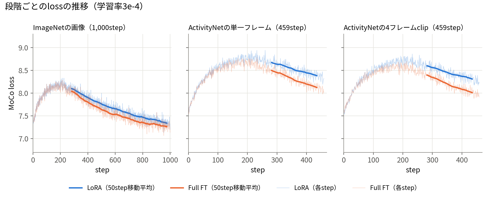
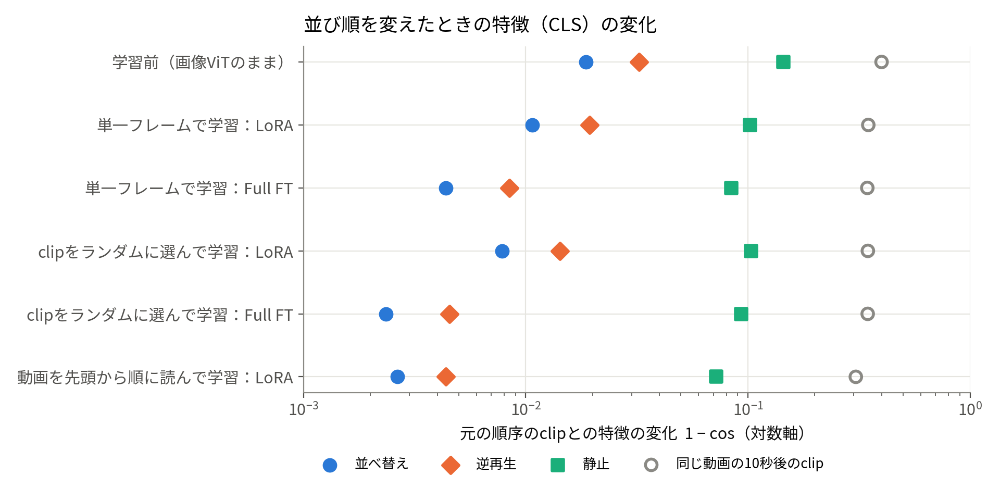

# 実験結果のまとめと考察：事前学習の経路と、並び順への反応（〜2026-11-17）

- 11/12 MTGの「次やること」2（今の結果を、数値と根拠が分かる形にまとめる）に対応する資料です。11/17に完走したstride 8の学習も含めました。
- 11/12の決定事項5に従い、どの表にも元の実験記録へのリンクを付けました（7章にも一覧があります）。
- 流れは「何をしたのか（1章）→ 結果（2章、表で比較）→ わかること（3章）→ 考察（4章）」です。
- 次回MTGの日程は、Research Workspace上では確認できていません（`target_meeting` は未設定）。

## 0. 要点

**何をしたのか**

- 画像で事前学習したViT-B/16にLoRA（attentionのQ・V、rank 8）を付けて、MoCo v2で学習しました。
- 入力を次の順に1段階ずつ差し替え、どの段階でも学習が崩れないかを確かめました。
  1. ImageNetの画像
  2. ActivityNetの単一フレーム
  3. ActivityNetの4フレームclip（early fusion）
  4. 動画を先頭から順に読む学習（stride 16と8）
- 最後に、学習したモデルの特徴が、フレームの並び順を変えたときにどれだけ変わるかを測りました。

**わかったこと**

1. 学習率0.03では、ViTのMoCoが最初の更新で潰れました（特徴が1方向に集まる＝collapse）。3e-4に下げると起きなくなりました。それ以降のすべての段階で、学習は最後まで進み、lossは下がり、collapseは起きませんでした。
2. 動画を順に読む学習（6,255step）では、lossは約7まで下がり、後半はほぼ横ばいでした。stride 8と16で、lossはほぼ同じでした（差は0.02〜0.06）。
3. どのモデルでも、並び順を入れ替えても特徴はほとんど変わりませんでした（cos 0.97〜0.998）。学習するとさらに鈍くなり、順に読んで学習したLoRAが最も鈍くなりました。
4. 最も似た負例のcosが正例のcosを上回る現象は、シャッフルして学習した場合にも起きていました。stride 8では、stride 16よりもその差が大きくなりました。

**考察（見立て）**

- 今の学習の目的は、見た目（背景・物体）だけで解けます。そのため、時間の情報は特徴に入っていません。lossの低下は、主に「別の動画との区別」によるものと考えています。
- 一方で、LoRAが動いていないわけではありません。確認用画像の特徴は、学習前から大きく変わりました（学習前の特徴とのcosが0.82まで低下）。「LoRAは動いたが、時間の情報には使われていない」可能性が高いと考えています（仮説）。11/12に決めたLoRAの特異値分解で、これを数値で確かめます。

## 1. 何をしたのか

### 1.1 目的

研究の問いは、次のとおりです。

> 画像で事前学習したViTに動画を逐次的に入力し、LoRAだけを学習すると、LoRAに時間・動きの情報が入るか。

その手前の段階として、次の2点を確かめました。

- (a) 学習の経路が、崩れずに最後まで動くか
- (b) 学習したモデルの特徴が、フレームの並び順に反応するか

### 1.2 共通の設定

| 項目 | 内容 |
|---|---|
| モデル | ViT-B/16（`google/vit-base-patch16-224`）＋projector（768→768→128） |
| 学習方式 | LoRA（Q・V、rank 8、事前学習の重みは固定）。比較のため、一部の段階ではFull FTも実施 |
| MoCo v2 | 負例の待ち行列（Queue）は65,536個、momentum 0.999、temperature 0.2。正例は同じ入力に別のデータ拡張をかけたもの |
| 学習 | 2 GPU、全体のbatch 256、AdamW、学習率は一定、seed 0（すべて1 seed） |
| collapseの確認 | ImageNetから固定した64枚の画像（確認用画像）の特徴どうしのcos。1に近いほど、違う画像なのに同じ向きの特徴になっている |

### 1.3 実験の一覧

| # | 段階 | 入力 | 方式 | step | 記録 |
|---|---|---|---|---|---|
| E1 | ImageNet、学習率0.03 | 画像 | LoRA・Full FT | 10 | [D4](../experiments/2026-10-22-vit-moco-query-collapse-d4-imagenet-gpu-diagnostic-evidence.md) |
| E2 | ImageNet、学習率3e-4 | 画像 | LoRA・Full FT | 10、1,000 | [L4](../experiments/2026-10-31-vit-moco-low-lr-l4-imagenet-gpu-evidence.md)・[L5](../experiments/2026-11-01-vit-moco-low-lr-l5-1000step-imagenet-gpu-evidence.md) |
| E3 | ActivityNet 単一フレーム | 10秒ごとのフレーム117,522枚（1周＝459step）、シャッフル | LoRA・Full FT | 459 | [LoRA](../experiments/2026-11-03-vit-moco-lora-activitynet-a2-lora-gpu-evidence.md)・[Full FT](../experiments/2026-11-03-vit-moco-lora-activitynet-a2-full-ft-gpu-evidence.md) |
| E4 | ActivityNet 4フレームclip | 0.25秒間隔の4フレームのtokenを結合してViTへ入れる（early fusion）。clipはシャッフル | LoRA・Full FT | 459 | [LoRA](../experiments/2026-11-03-vit-moco-lora-activitynet-clip-a2-lora-gpu-evidence.md)・[Full FT](../experiments/2026-11-03-vit-moco-lora-activitynet-clip-a2-full-ft-gpu-evidence.md) |
| E5 | 順に読む、stride 16 | 1 GPUあたり128本の動画を先頭から並列に読む。16フレームおきの4枚を1 clipとする（30 fpsで約0.53秒間隔） | LoRA | 6,255 | [記録](../experiments/2026-11-04-sequential-loader-clip-moco-lora-g2-gpu-evidence.md)・[Comet](https://www.comet.com/haruto2919/2026-09-ishikawa-sequential-video-lora/d7089226ac604f169c491873800299c3) |
| E6 | 順に読む、stride 8 | E5と同じで、8フレームおき（約0.27秒間隔）だけが違う | LoRA | 6,255 | [記録](../experiments/2026-11-16-sequential-loader-clip-moco-lora-stride8-gpu-run.md)・[Comet](https://www.comet.com/haruto2919/2026-09-ishikawa-sequential-video-lora/aabfeb370e944828bb4333a8e4f27676) |
| V1 | 並び順への反応の評価 | ActivityNet validationの2,000 clip（学習に使っていない動画） | 学習前・E3・E4・E5の6モデル | — | [5モデル](../experiments/2026-11-04-temporal-order-sensitivity-evaluation-r1-gpu-evidence.md)・[E5を追加](../experiments/2026-11-11-temporal-order-sensitivity-evaluation-g2-gpu-evidence.md) |

- E2以降の学習率はすべて3e-4です。6,255stepは約640万フレーム（256 clip×4フレーム×6,255）です。
- 研究コードは `tamaki-lab/2026_09_ishikawa_sequential-video-lora` の `feature-vit-moco` ブランチです。各runのcommitは記録を参照してください（E5は `f16a485`、E6は `59bade2`）。
- Cometに記録があるのはE5とE6だけです。それ以外は、研究サーバ上のrunのディレクトリが記録の正本です。
- E6（stride 8）は、まだ並び順の評価（V1）にかけていません。

## 2. 結果

### 2.1 学習率とcollapse（E1・E2、ImageNet）

固定した64枚の確認用画像について、特徴どうしのcos（中央値）を示します。学習前の値は、CLSが0.032、`z_q`（projectorの出力）が0.32、`q std`が0.073です。

| run | CLS step 1 | CLS step 10 | `z_q` step 1 | `z_q` step 10 | `q std` step 10 |
|---|---|---|---|---|---|
| LoRA、0.03 | 0.032 | 0.269 | **0.993** | **0.994** | 0.0076 |
| LoRA、3e-4 | 0.032 | 0.032 | 0.453 | 0.455 | 0.0649 |
| Full FT、0.03 | **0.985** | **1.000** | **0.9999** | **1.000** | **0.0000045** |
| Full FT、3e-4 | 0.038 | 0.029 | 0.495 | 0.392 | 0.0685 |

- 出典：[L4の記録](../experiments/2026-10-31-vit-moco-low-lr-l4-imagenet-gpu-evidence.md)の比較表。`q std` は、正規化した特徴の次元ごとのばらつきです。0に近いほど潰れています（上限の目安は1/√128 ≈ 0.088）。
- step 1の勾配は、学習率によらず同じでした。更新量だけが1/100になりました（例：projectorの相対更新量は1.44→0.0144）。
- 3e-4で1,000stepまで延ばしたE2（L5）でも、潰れは起きませんでした。step 1,000での値は、`z_q` 0.0046（LoRA）・0.0004（Full FT）、`q std` 0.087でした。
- 注意：0.03と3e-4の実験では、GPUの1枚が違います。そのため、比較器は厳密な比較ではないと判定しています（`comparable=false`）。ただし、差は桁違いに大きいです。

### 2.2 段階ごとのloss（E2〜E6）

Queueが実際の特徴で埋まった後（step 257以降）の、最初の窓の平均lossと最後の窓の平均lossです。step 256までは、Queueのランダムな初期値が実際の特徴に置き換わる途中なので、lossは上がります（どの段階でも同じ）。

| 段階 | step | LoRA | Full FT |
|---|---|---|---|
| E2：ImageNet | 1,000 | 8.06 → 7.37 | 7.99 → 7.28 |
| E3：単一フレーム | 459 | 8.67 → 8.38 | 8.50 → 8.12 |
| E4：4フレームclip（シャッフル） | 459 | 8.60 → 8.31 | 8.40 → 8.01 |
| E5：順に読む、stride 16 | 6,255 | 8.35 → 6.96 | — |
| E6：順に読む、stride 8 | 6,255 | 8.41 → 7.00 | — |

- 窓の大きさは、E2が100step、E3・E4が50step、E5・E6が250stepです。
- どの段階でも、確認用画像の特徴は潰れていませんでした（`z_q` のcosはstep 256以降に約0.1、`q std` は約0.083〜0.087）。
- 同じ段階では、Full FTのlossがLoRAより0.1〜0.3低いです。ただし1 seedなので、どちらが優れているかは言えません。

**この図で見る点**：どの段階でも、step 256までlossが上がり、その後は下がり続けています。LoRA（青）とFull FT（橙）は同じ形です（[manifest](../experiments/figures/2026-11-03-pretraining-loss-by-stage/manifest.md)）。

**計算コスト（参考）**

| 段階 | 1stepの時間 | GPU 1のメモリ（peak reserved） | 1本の所要時間 |
|---|---|---|---|
| E3 LoRA／Full FT | 3.8秒／2.5秒（読み込み待ちを含む） | 12,338 MiB／18,346 MiB | 約35分／約25分 |
| E4 LoRA／Full FT | 9.9秒／10.5秒 | 12,784 MiB／13,112 MiB | 約82分／約87分 |
| E5・E6 LoRA | 計算8.8秒＋読み込み待ち約2.5〜3秒 | 12,784 MiB | 約22時間（中断を含む）／約20時間 |

### 2.3 順に読む学習：stride 16（E5）とstride 8（E6）

stride以外の設定（学習率、step数、並列に読む本数など）はすべて同じです。

**loss（250step窓の平均）**

| 窓（step） | stride 16 | stride 8 | 差（8 − 16） |
|---|---|---|---|
| 257〜506 | 8.348 | 8.412 | +0.064 |
| 1,007〜1,256 | 7.632 | 7.651 | +0.019 |
| 2,007〜2,256 | 7.308 | 7.335 | +0.027 |
| 3,007〜3,256 | 7.140 | 7.170 | +0.030 |
| 4,007〜4,256 | 7.078 | 7.114 | +0.036 |
| 5,007〜5,256 | 6.991 | 7.043 | +0.052 |
| 6,006〜6,255 | 6.964 | 6.998 | +0.034 |

**正例のcosと、最も似た負例のcos**

学習batchの中で測った値です。「差」は（最も似た負例のcos）−（正例のcos）で、正なら、Queueの中に正例より近い負例があることを意味します。

| 窓（step） | 正例 stride 16 | 正例 stride 8 | 差 stride 16 | 差 stride 8 |
|---|---|---|---|---|
| 257〜506 | 0.522 | 0.509 | +0.079 | +0.094 |
| 1,007〜1,256 | 0.746 | 0.745 | +0.052 | +0.069 |
| 2,007〜2,256 | 0.825 | 0.823 | +0.026 | +0.044 |
| 3,007〜3,256 | 0.858 | 0.857 | +0.016 | +0.034 |
| 4,007〜4,256 | 0.868 | 0.867 | +0.015 | +0.026 |
| 5,007〜5,256 | 0.886 | 0.880 | +0.008 | +0.027 |
| 6,006〜6,255 | 0.889 | 0.887 | +0.007 | +0.022 |

- 参考：シャッフルした学習でも、この差は正でした。step 410〜459の窓で、E3 LoRAは+0.055（0.566と0.511）、E4 LoRAは+0.044（0.571と0.527）でした。窓の位置と大きさが違うため、E5・E6と直接は比べられません。
- 負例全体の平均cosは、E5ではstep 2,000以降ほぼ0でした。

**読んだ動画の量と、確認用画像の特徴（step 6,255）**

| 項目 | stride 16 | stride 8 |
|---|---|---|
| 1 clipが読む範囲 | 64フレーム | 32フレーム |
| 全動画を何周したか | 約4.2周（epochの長さは1,600・1,580・1,413・1,419step） | 約2周（epoch 0が3,184step、epoch 1の途中で停止） |
| `z_q` のcos 中央値／95%点 | 0.096／0.381 | 0.081／0.368 |
| `q std` | 0.083 | 0.083 |
| CLSの、学習前の特徴とのcos（中央値） | 0.825 | 0.815 |

- 学習に入れたフレーム数は同じですが、読んだ動画の時間（周回数）はそろっていません。動画の量でそろえるには、stride 8で約12,500stepが必要です。

**学習中に、確認用画像の特徴がどれだけ動いたか（CLSの、学習前の特徴とのcos中央値）**

| step | 256 | 1,000 | 2,000 | 3,000 | 4,000 | 5,000 | 6,255 |
|---|---|---|---|---|---|---|---|
| stride 16 | 0.985 | 0.960 | 0.934 | 0.905 | 0.878 | 0.856 | 0.825 |
| stride 8 | 0.985 | 0.960 | 0.926 | 0.900 | 0.874 | 0.847 | 0.815 |

- 参考：E4 LoRA（シャッフル、459step）はstep 459で0.978でした。
- 学習するのはLoRAだけで、事前学習の重みは固定です。そのため、この変化はすべてLoRAによるものです。

### 2.4 並び順への反応（V1）

**測り方**

- ActivityNet validationから2,000 clip（4フレーム、0.25秒間隔）を選びました。
- 元の順序のclipの特徴（最終層のCLS）と、次のように変えたclipの特徴とのcosを測りました（2,000 clipの平均）。
  - 並べ替え：ランダムな順序にする
  - 逆再生：4→3→2→1
  - 静止：最後のフレームを4回繰り返す
  - 10秒後：同じ動画の10秒後のclip
  - 別の動画：別の動画のclip
- 1に近いほど、変えても特徴が変わらない（その変化に鈍い）ことを表します。

| モデル | 並べ替え | 逆再生 | 静止 | 10秒後 | 別の動画 |
|---|---|---|---|---|---|
| 学習前 | 0.981 | 0.968 | 0.856 | 0.600 | 0.081 |
| E3 単一フレーム LoRA | 0.989 | 0.981 | 0.898 | 0.652 | 0.094 |
| E3 単一フレーム Full FT | 0.996 | 0.992 | 0.916 | 0.655 | 0.051 |
| E4 clip LoRA | 0.992 | 0.986 | 0.897 | 0.653 | 0.093 |
| E4 clip Full FT | 0.998 | 0.996 | 0.907 | 0.654 | 0.046 |
| **E5 順に読む LoRA** | **0.997** | **0.996** | **0.928** | **0.694** | 0.079 |

- 出典：[E5を加えた評価の記録](../experiments/2026-11-11-temporal-order-sensitivity-evaluation-g2-gpu-evidence.md)。MoCoの出力（`q`）でも同じ傾向でした。別の動画とのcosは、`q` では学習前0.363、E4 LoRA 0.022、E5 0.008でした。
- E5 − E4 LoRAの差（`q`、同じclipどうしのbootstrapによる95%区間）は、次のとおりで、いずれも0をまたぎません。
  - 並べ替え +0.0049、逆再生 +0.0092、静止 +0.0254、10秒後 +0.0277、別の動画 −0.0139
- 並べ替え・逆再生・静止の差は、動きの大きいclipで大きくなりました。

**この図で見る点**：並べ替え・逆再生による変化（1 − cos）は、内容が変わったとき（10秒後）より1〜2桁小さいです。また、学習するほど、変化はさらに小さくなります（[manifest](../experiments/figures/2026-11-11-temporal-order-sensitivity-sequential-lora/manifest.md)）。

## 3. わかること（結果から直接言えること）

| # | わかること | 根拠 | 強さ |
|---|---|---|---|
| 1 | ViTのMoCoが潰れたのは、学習率0.03での最初の更新が大きすぎたため。3e-4なら1,000stepでも潰れない | 2.1 | 強く支持（GPUが違うため厳密な比較ではない） |
| 2 | 画像→単一フレーム→clip→順に読む、のどの段階でも、学習は最後まで進み、collapseせずにlossが下がる | 2.2 | 観測（工学的な確認） |
| 3 | 順に読む学習のlossは約7で横ばいになる。stride 8と16で、lossと正例のcosはほぼ同じ | 2.3 | 観測（1 seed） |
| 4 | stride 8のほうが、最も似た負例が正例より近い度合いが全期間で大きい | 2.3 | 観測（1 seed） |
| 5 | 最も似た負例が正例より近いこと自体は、シャッフルした学習でも起きる | 2.3の参考 | 観測 |
| 6 | どのモデルも、並び順の入れ替えに対して特徴がほぼ変わらない。学習すると鈍くなり、順に読んだLoRAが最も鈍い | 2.4 | 観測（記述的、1 seed） |
| 7 | 順に読んだLoRAは、別の動画とは最も離れ、同じ動画の10秒後とは最も近い | 2.4 | 観測 |
| 8 | LoRAだけで、確認用画像のCLSが学習前から大きく変わる（cos 0.82）。この変化は学習の後半も続いている | 2.3 | 観測 |

## 4. 考察

### 4.1 なぜ並び順の情報が入らないのか

- **学習の目的が、見た目だけで解けるため**（支持される解釈）。
  - 正例は「同じclipに2種類のデータ拡張をかけたもの」です。背景や物体の見た目が一致していれば正解でき、並び順を見る必要がありません。
  - early fusionと時間位置埋め込みによって、構造上は時間を扱えるようにしています。しかし、それを使う必要が学習の中で生じていません。
- 学習前のモデルでも、逆再生でわずかに特徴が変わります（1 − cos ＝ 0.032）。これは、時間位置埋め込みとフレーム間のattentionによるもので、学習で身についたものではありません。
- 学習すると、見た目の手がかりが強まります。その結果、並び順による違いが相対的に小さくなったのではないかと考えています（仮説、わかること6）。

### 4.2 lossの低下は何によるのか

- **主に「別の動画との区別」によるものと考えています**（支持される解釈）。根拠は次のとおりです。
  - 負例全体の平均cosがほぼ0になった。
  - 別の動画との`q`のcosがほぼ0（0.008）になった。
  - 一方で、同じ動画の10秒後のclipとは近づいた。
- つまり、学習は「この動画らしさ」（動画全体でほぼ同じ特徴）を作る方向に進んだ、と読めます。
- 順に読むと、Queueには同じ動画の少し前のclipが入ります。しかし、1本の動画のclipはQueue全体の最大約0.4％（65,536個のうち256個）です。そのため、同じ動画の中を見分ける圧力は弱いのではないかと考えています（仮説、未確認）。

### 4.3 stride 8と16の比較から言えること

- stride 8では、Queueに入る同じ動画の直前のclipとの時間差が半分になります。最も似た負例がより近くなったこと（わかること4）は、「最も似た負例は、同じ動画の直前のclipである」という見立てと合っています（間接的な根拠、未確認）。
- ただし、わかること5のとおり、最も似た負例が正例より近いこと自体は、シャッフルした学習でも起きます。そのため、65,536個の負例を使うMoCoではもともと起こり得ることで、同じ動画のclipはそれを強める要因の一つ、と考えるのが妥当です（解釈）。
- 負例が近くなっても、正例のcos、確認用画像の特徴、lossへの影響はわずかでした。近い負例は学習を壊さない一方で、同じ動画の中を区別させる効果も、lossからは見えません。
- 読んだ動画の量が約半分（約2周と約4.2周）でも、lossはほぼ同じでした。考えられる理由は次の2つで、どちらかはまだ分けられていません。
  - この規模では、同じ動画を何周したかより、step数（入れたフレーム数）でlossが決まっている。
  - 今の学習の目的では、lossがすでに下がりにくい水準に近い。

### 4.4 LoRAは動いていないのか

- 11/12のMTGで、教授は「LoRAはほとんど動いていない」と予想していました。
- 今回の結果では、LoRAだけで、確認用画像（ImageNet）のCLSが学習前からcos 0.82まで変わりました（わかること8）。少なくとも特徴への影響は小さくありません。
- そのため、「LoRAが効いていない」よりも、**「LoRAは効いているが、時間の情報ではなく、動画どうしを見た目で区別するために使われている」**可能性が高いと考えています（仮説）。
- 重みの特異値分解で、次の2つを確かめれば数値で言えます（11/12の決定事項2）。
  - LoRAの重みの大きさ（事前学習の重みの特異値との比）
  - LoRAの初期値からの距離
- ただし、重みの大きさと特徴の変化の対応は、まだ確認していません。

### 4.5 この結果の限界

- すべて1 seedです。
- E5とE4の違いは、読み方だけによるものではありません。学習量（13.6倍）とフレームの間隔も違います。
- 並び順の評価は0.25秒間隔のclipで行いました。学習時の間隔（E5は約0.53秒）とは違います。
- 評価はラベルを使わないcosだけです。cosが1に近くても、線形分類器なら順再生か逆再生かを当てられる可能性は残ります。表現の良し悪し（下流タスクの性能）も分かりません。
- 確認用画像はImageNetの静止画なので、ActivityNetでの特徴の質は示しません。

## 5. 今回言えること／まだ言えないこと

**言えること**

- 画像ViT＋LoRA＋MoCo（early fusion）の事前学習は、ActivityNetの動画を先頭から順に読む設定でも、stride 8・16のどちらでも、collapseせずにlossが下がるところまで動く。
- 今の学習の目的では、並び順を区別する情報は特徴に現れない。順に読んで長く学習しても同じで、むしろ時間の変化に鈍くなる。
- LoRAは、少なくとも特徴を大きく変える程度には動いている。

**まだ言えないこと**

- LoRAが何を獲得したか（静的な情報か、動的な情報か）。重みの解析をまだしていません。
- strideによって、並び順への反応やLoRAの中身が変わるか。stride 8はまだ評価していません。
- 順に読んだLoRAが鈍くなった原因が、学習量、フレームの間隔、読み方のどれか。
- 表現の良し悪し。

## 6. 次に確かめること・相談したいこと

11/12 MTGの方針（先にLoRAを解析して現状を数値で示す）に沿った候補です。まだspecやTODOにはしていません。

| 候補 | 分かること | コストの目安 |
|---|---|---|
| E3〜E6のLoRAの重みを特異値分解する（E5・E6は途中のcheckpoint 1,000〜6,000も） | LoRAがどれだけ動いたか。シャッフルと順に読む学習、stride 8と16の違い | 学習は不要 |
| E6（stride 8）を並び順の評価にかける | strideで並び順への反応が変わるか | 約16分（E5の評価の実績） |
| E5・E6の途中のcheckpointを並び順の評価にかける | 鈍くなる原因が学習量か読み方か | 評価だけ |

**相談したいこと**

1. LoRAの解析は、E3（単一フレーム）・E4（シャッフルclip）・E5・E6（順に読む）の4本から始めてよいか。
2. stride比較で、何をそろえるか。step数（入れたフレーム数）でそろえるか、読んだ動画の量でそろえるか。動画の量でそろえる場合、stride 8は約12,500step（約40時間）が必要です。

## 7. 参照ファイル

**実験記録**

- ImageNet：[学習率0.03（D4）](../experiments/2026-10-22-vit-moco-query-collapse-d4-imagenet-gpu-diagnostic-evidence.md)・[3e-4、10step（L4）](../experiments/2026-10-31-vit-moco-low-lr-l4-imagenet-gpu-evidence.md)・[3e-4、1,000step（L5）](../experiments/2026-11-01-vit-moco-low-lr-l5-1000step-imagenet-gpu-evidence.md)
- 単一フレーム：[LoRA](../experiments/2026-11-03-vit-moco-lora-activitynet-a2-lora-gpu-evidence.md)・[Full FT](../experiments/2026-11-03-vit-moco-lora-activitynet-a2-full-ft-gpu-evidence.md)
- 4フレームclip：[LoRA](../experiments/2026-11-03-vit-moco-lora-activitynet-clip-a2-lora-gpu-evidence.md)・[Full FT](../experiments/2026-11-03-vit-moco-lora-activitynet-clip-a2-full-ft-gpu-evidence.md)
- 順に読む学習：[stride 16](../experiments/2026-11-04-sequential-loader-clip-moco-lora-g2-gpu-evidence.md)（[Comet](https://www.comet.com/haruto2919/2026-09-ishikawa-sequential-video-lora/d7089226ac604f169c491873800299c3)）・[stride 8](../experiments/2026-11-16-sequential-loader-clip-moco-lora-stride8-gpu-run.md)（[Comet](https://www.comet.com/haruto2919/2026-09-ishikawa-sequential-video-lora/aabfeb370e944828bb4333a8e4f27676)）
- 並び順の評価：[学習前・単一フレーム・clipの5モデル](../experiments/2026-11-04-temporal-order-sensitivity-evaluation-r1-gpu-evidence.md)・[順に読んだLoRAを追加](../experiments/2026-11-11-temporal-order-sensitivity-evaluation-g2-gpu-evidence.md)

**計画書**

- [学習率の任意指定](../specs/2026-10-22-vit-moco-configurable-learning-rate-collapse-control-spec.md)・[長めの学習](../specs/2026-10-31-vit-moco-low-lr-long-run-spec.md)
- [単一フレーム](../specs/2026-11-01-vit-moco-lora-activitynet-single-frame-spec.md)・[4フレームclip（early fusion）](../specs/2026-11-03-vit-moco-lora-activitynet-clip-early-fusion-spec.md)
- [順に読む学習](../specs/2026-11-04-sequential-loader-clip-moco-lora-6255step-spec.md)・[並び順の評価](../specs/2026-11-03-temporal-order-sensitivity-evaluation-spec.md)

**MTG・資料**

- [11/12 MTG議事録](../meetings/2026-11-12-mtg.md)
- [11/12 MTG資料（10/22以降の進捗と並び順の結果）](2026-11-11-progress-since-1022-and-temporal-order-results-mtg-materials.md)

**図**（既存の図を再利用。この資料のための新しい図は作っていません）

- [段階ごとのlossの推移](../experiments/figures/2026-11-03-pretraining-loss-by-stage/01-loss-by-stage.png)
- [学習率による確認用画像のcosの推移](../experiments/figures/2026-11-01-imagenet-learning-rate-collapse/01-probe-cosine-by-lr.png)
- [順に読む学習（stride 16）のlossとcos](../experiments/figures/2026-11-09-sequential-loader-lora-loss/01-loss-and-cosine.png)
- [並び順を変えたときの変化](../experiments/figures/2026-11-11-temporal-order-sensitivity-sequential-lora/01-order-change-cls.png)
