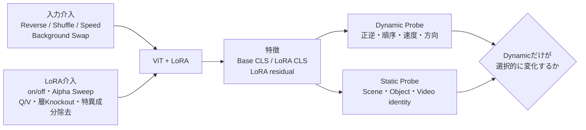
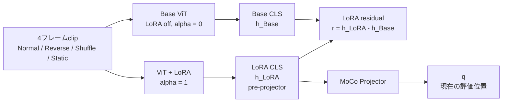
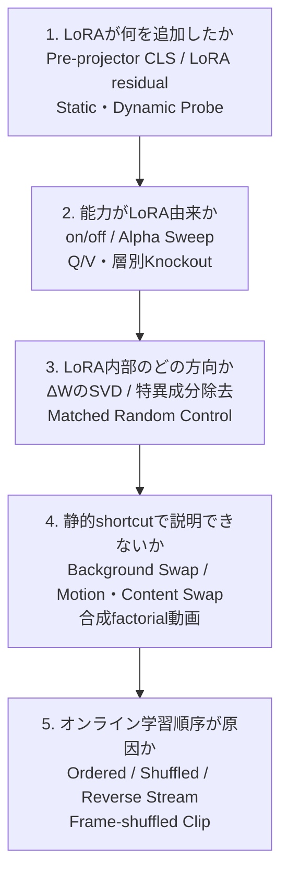

# LoRAが動的情報を学習したか調べたい

> **Notionへ貼るとき**：この見出し（H1）から下をコピーしてください（上のfrontmatterは除く）。
> - ブロック数式は `$$ … $$`、インライン数式は `$ … $` で書いてあります。
> - 論文の図は、arXiv HTML版の画像URLを埋め込んでいます。
> - 自作の図はMermaidコードブロックです。Notionで表示を「プレビュー」に切り替えると図になります。

- メイン目的：動画から学習したLoRAが、物体・背景などの静的情報ではなく、順序・方向・速度・状態遷移などの動的情報を獲得したか検証したい
- サブ目的1：一般的なLoRAの解析方法を整理したい
- サブ目的2：LoRAに限らず、静的情報と動的情報を分離して評価する方法を知りたい
- サブ目的3：現在のStreaming MoCo＋ViT＋LoRAに適用できる実験方法へ落とし込みたい

GitHub上の調査結果

### 調査で分かったこと

- LoRAの重みをSVDするだけでは「動的情報を学習した」とは判断できない
- reverseやshuffleによって特徴量が変化するだけでも不十分
    - 時間順序を正しく理解したのではなく、単に入力変化に反応しただけかもしれない
- ActivityNetの分類精度だけでも不十分
    - 背景・場所・物体などの静的情報だけで分類できる場合がある
- 最も確実なのは、以下の3種類の評価を組み合わせること

| 評価の軸 | 確認すること |
| --- | --- |
| 入力への介入 | 順序・速度・方向・背景などを意図的に変更する |
| LoRAへの介入 | LoRAを無効化・縮小・部分除去し、能力が落ちるか確認する |
| Static／Dynamic Probe | 静的情報と動的情報を別々のタスクで読み出す |

したがって、今回の研究では

**入力介入 × LoRA介入 × Static／Dynamic Probe**

の3方向から調べる必要がある。

**図A（自作）：3方向の評価の組み合わせ方**

#### 現時点の結論

LoRAが動的情報を学習したと主張するには、少なくとも次を確認する必要がある。

1. Base ViTよりLoRAありの方が、順序・方向・速度などを正しく判別できる
2. 背景や物体を変更しても、その動的情報の判別能力が維持される
3. LoRAを無効化すると、その能力が低下する
4. LoRAの特定の層・Q/V・特異成分を除去すると、動的能力が選択的に低下する
5. 静的情報の性能向上だけでは結果を説明できない

---

### 現在のG2-LoRAの解析結果

ActivityNet validationから2,000 clipを使用し、1 clipを4フレーム、フレーム間隔0.25秒として評価した。

| 入力条件 | Normalとのq cosine similarity |
| --- | --- |
| Shuffle | 0.9982 |
| Reverse | 0.9971 |
| Static | 0.9331 |
| Same Video | 0.6995 |
| Other Video | 0.0082 |

#### この結果から確認できること

- 別動画の特徴は明確に異なっている
- 同じ動画内の別clipにも、ある程度の共通性がある
- Staticでは特徴が変化しているため、フレーム間の見た目の変化には反応している
- 一方、ShuffleとReverseではNormalとほとんど同じ特徴が得られている
- 現在の評価では、フレームの並び順を区別する情報を獲得したとは確認できていない

#### 注意点

この結果だけから「G2-LoRAは動的情報を全く持っていない」と断定することはできない。

理由は以下の通り。

- cosine similarityは、特徴全体の変化しか見ていない
- 特徴差が小さくても、特定方向に順序情報が埋め込まれている可能性がある
- Projector後のqを評価しているため、LoRAだけでなくProjectorの影響も含まれる
- 1 seed・1データセット・短いclipでの記述的な結果である
- linear probeなどを使えば、微小な差から順序を読み出せる可能性がある

そのため、今後はpre-projector CLSとLoRA residualを使った機能評価が必要になる。

---

### 一般的なLoRAの解析方法

LoRAの実効更新は、以下で表される。

$$
W' = W_0 + \Delta W
$$

$$
\Delta W = sBA
$$

- $W_0$ ：事前学習済みのBase重み
- $A, B$ ：LoRAによって学習される低ランク行列
- $s$ ：LoRAのスケーリング
- $\Delta W$ ：LoRAがBaseモデルへ追加した実際の重み変化

解析では、原則として $A$ と $B$ を別々に見るのではなく、実効更新である $\Delta W$ を見る。

$A$ と $B$ は分解方法が一意ではなく、 $A$ だけ、 $B$ だけに意味を与えることが難しいためである。

| 解析方法 | 測定するもの | 分かること | 単独では分からないこと |
| --- | --- | --- | --- |
| 更新量解析 | $\lVert \Delta W \rVert_F$ 、Baseに対する相対更新量 | どの層が大きく変化したか | 動的情報を学習したか |
| SVD | 特異値・特異ベクトル・累積energy | LoRAが少数方向へ集中しているか | 各方向が動作概念か |
| Effective Rank | 実際に利用されているrank | LoRA容量の使われ方 | そのrankが表す意味 |
| Baseとの部分空間比較 | 主角度・射影energy | Baseと同じ方向か、新しい方向か | 新しい方向が動的か |
| LoRA間比較 | ordered／shuffle間の主角度など | 学習条件による更新方向の違い | 違いが有用か |
| CKA・SVCCA | 層ごとの表現類似度 | どの層で表現が変化したか | 変化が正しいか |
| Residual解析 | LoRAあり特徴－Base特徴 | LoRAが追加した情報 | その情報の因果的重要性 |
| Alpha Sweep | LoRAの強度を0～1以上で変更 | LoRA効果の用量反応 | 極端なalphaでの分布外挙動 |
| Module Knockout | 層・Q/V・headを無効化 | どの部分が能力に必要か | 冗長な情報の存在 |
| 特異成分除去 | SVD上位成分などを除去 | 特定方向の因果的な重要性 | ノルム減少による一般的影響 |
| Random Control | 同rank・同normのランダム除去 | SVD成分固有の効果か | データ側のshortcut |

#### 論文の図で見る：Baseとの部分空間比較

LoRAの原論文でも、「 $\Delta W$ がBase重み $W$ のどの方向を使っているか」を部分空間類似度で調べている。

*図1：Hu et al., "LoRA: Low-Rank Adaptation of Large Language Models", ICLR 2022, Figure 8（[arXiv:2106.09685](https://arxiv.org/abs/2106.09685)）。左3枚は $W_q$ の特異方向と $\Delta W_q$（ $r=4, 8, 64$ ）の類似度、右端はランダム行列との比較。*

- 読み方：ランダム行列（右端）より類似度が高く、また $W_q$ の上位特異方向そのものではなく、 $W$ で強調されていない方向を $\Delta W$ が増幅している、と論文は結論している（GPT-3の48層目）。
- この研究への示唆：ViT＋LoRAでも同じ手順で「LoRAがBase ViTの既存方向を増幅したのか、新しい方向を足したのか」は測れる。ただし、それが**動的情報の方向かどうかは、この図の手法だけでは分からない**。

---

### 特異値分解（SVD）で調べられること

LoRAの実効更新を次のように分解する。

$$
\Delta W = U\Sigma V^\top
$$

- $U$ ：出力側の変化方向
- $V$ ：入力側の変化方向
- $\Sigma$ ：各方向の強さを表す特異値

#### SVDで分かること

- LoRAの更新が何個程度の方向に集中しているか
- 特定の層だけ大きく更新されているか
- Q-LoRAとV-LoRAで更新の特徴が異なるか
- ordered学習とshuffled学習で部分空間が異なるか
- 学習途中でLoRAの主要方向がどのように変化したか
- Baseモデルの主要方向を上書きしているか、別方向を使っているか

#### SVDだけでは分からないこと

- 高い特異値が動的情報を表しているか
- 1つの特異方向が1つの動作概念に対応しているか
- rankの数が学習した動作概念数と一致するか
- 大きな更新がモデル性能に必要か
- 更新が静的情報と動的情報のどちらに利用されているか

したがって、

**高特異値＝重要な動作概念**

とは判断できない。

#### 論文の図で見る：LoRAの特異方向は「新しい方向」になりやすいが、それが能力とは限らない

*図2：Shuttleworth et al., "LoRA vs Full Fine-tuning: An Illusion of Equivalence", Figure 2（[arXiv:2410.21228](https://arxiv.org/abs/2410.21228)）。(a) 事前学習重み $W_0$ 、LoRA後、Full FT後の重みをそれぞれSVDして特異ベクトルを対応づける。(b) LoRA後の特異ベクトル（赤）は、 $W_0$ のどの特異ベクトルとも似ていないものが多い。(c) そのような方向を intruder dimension と呼ぶ。*

- 読み方：LoRAは、Base重みのどの特異方向とも似ていない「新しい上位特異方向」を作ることがある。

*図3：同論文 Figure 13（本文Figure 8と同じ実験の全条件版）。横軸は上位intruder dimensionの特異値に掛ける倍率 $\lambda$（ $\lambda=1$ が元のLoRA、 $\lambda=0$ が除去）。緑はfine-tuningタスクの精度、赤は事前学習分布での損失（忘却）。*

- 読み方：上位のintruder dimensionを縮小しても、タスク精度（緑）はほとんど変わらない一方、忘却（赤）は大きく減る。
- この研究への示唆：
    - **上位の特異方向でも、獲得した能力に必要とは限らない**。「高特異値＝重要な動作概念」とは言えない根拠になる。
    - 特異成分を縮小・除去し、**機能タスク**（ここでは精度と忘却）で影響を測るという介入手順は、そのまま「特異成分除去 → Dynamic／Static Probeを再評価」に置き換えられる。
    - 横軸 $\lambda$ を連続的に動かす形は、後述のAlpha Sweepと同じ発想である。

#### 推奨するSVD評価

1. 各層の $\Delta W$ をSVDする
2. 上位特異成分を1つずつ除去する
3. 動的タスクと静的タスクを再評価する
4. 同じenergyを持つランダム方向の除去と比較する
5. 動的タスクだけが選択的に低下するか確認する

例えば、上位1成分を除去したときに

- Reverse判定：大きく低下
- 速度判定：大きく低下
- Scene分類：ほぼ変化なし
- ランダム成分除去：ほぼ変化なし

となれば、その特異成分が動的能力に関係しているという比較的強い証拠になる。

---

### 静的情報と動的情報を分ける方法

#### 作業上の定義

**静的情報**

- 物体
- 背景
- Scene
- 色
- 形
- 人物や物体のidentity
- 単一フレームから推定できる姿勢

**動的情報**

- 時間方向
- フレームの順序
- 速度
- 移動方向
- 状態遷移
- 周期
- 接近・離反
- 動作の開始・終了
- 出来事の因果的な前後関係

#### 注意する区別

| 用語 | 意味 |
| --- | --- |
| 時間感度 | 入力順を変えると特徴量が変化する |
| 時間能力 | 入力順・速度・方向などを正しく予測できる |
| 静動分離 | 静的因子を変更しても動的予測が維持される |
| オンライン効果 | サンプルが時間順・single-passで到着することによる効果 |

Reverseで特徴が変化しても、正しい時間方向を理解できているとは限らない。

そのため「感度」と「能力」を分けて評価する必要がある。

#### 論文の図で見る：静的情報と動的情報を「ペア」で測る方法

*図4：Kowal et al., "A Deeper Dive Into What Deep Spatiotemporal Networks Encode: Quantifying Static vs. Dynamic Information", CVPR 2022, Figure 2（[arXiv:2206.02846](https://arxiv.org/abs/2206.02846)）。①行動認識では、フレームをランダムにShuffleして「静的は同じ・動的は異なる」ペアを、Stylizationで「動的は同じ・静的は異なる」ペアを作る。②各ペアの特徴の相互情報量から、層・unitごとに静的／動的のどちらに偏っているかを推定する。*

- 読み方：入力介入（Shuffle・Stylization）を「静的だけ」「動的だけ」を変えるペアとして設計し、特徴がどちらの因子を保持しているかを層ごとに数値化している。
- この研究への示唆：
    - G2-LoRAのShuffle／Reverse実験は、このうち「静的は同じ・動的は異なる」側だけを見ている状態である。「動的は同じ・静的は異なる」ペア（Background Swap、Stylization）も揃えると、静動の両面から測れる。
    - Base CLSとLoRA CLSに同じ指標を適用すれば、**LoRAによって層ごとの静的／動的の偏りがどう変わったか**を比較できる。
    - 同論文の補足（Figure 16）では、静的／動的と判定した上位unitを除去した場合と**ランダムなunitを除去した場合**を比較している。後述のMatched Random Controlと同じ考え方である。

---

### 入力を変化させる評価方法

| 入力介入 | 維持されるもの | 変化するもの | 調べられること |
| --- | --- | --- | --- |
| Reverse | フレーム集合・物体・背景 | 時間方向 | 正逆・状態遷移 |
| Shuffle | フレーム集合 | フレーム順序 | 順序依存性 |
| Static Repeat | 1枚のappearance | フレーム間変化 | Motionの必要性 |
| Speed Change | 空間内容・軌跡 | 再生速度 | 速度表現 |
| Frame Drop | 大まかな内容 | 時間分解能 | 時間scaleへの頑健性 |
| Background Swap | 前景motion | 背景・scene | 背景shortcutへの依存 |
| Foreground Swap | 背景・軌跡 | 対象appearance | Motionとidentityの分離 |
| Motion Transfer | Content | Motion | Motion表現の移植可能性 |
| Content Transfer | Motion | Content | ContentとMotionの分離 |

ReverseとShuffleでは、単に特徴量のcosine similarityを見るだけでなく、以下を評価する。

- 正しい順序を選択できるか
- Forward／Reverseを分類できるか
- 速度を予測できるか
- 状態遷移の前後を判定できるか
- 順序を変えたときに正解ラベルも適切に変わるか

#### 論文の図で見る：Speed Probeでは「速さ」と「動きの大きさ」を区別する

*図5：Benaim et al., "SpeedNet: Learning the Speediness in Videos", CVPR 2020, Figure 2（[arXiv:2004.06130](https://arxiv.org/abs/2004.06130)）。人が行き来する同じ動画でも、カメラに近いほど画面上の動きは大きくなる。しかし再生速度（speediness）は変わらない。*

- この研究への示唆：Speed Probeを「動きが大きい／小さい」で代用すると、カメラとの距離や物体サイズという**静的要因**で解けてしまう。SpeedNetのように、**同じ動画を通常速度と早送りで比較する**形で速度ラベルを作る。Motion magnitudeは別のProbe（統制変数）として扱う。

#### 論文の図で見る：Background Swapの作り方

*図6：Ding et al., "Motion-aware Contrastive Video Representation Learning via Foreground-background Merging"（FAME）, CVPR 2022, Figure 4（[arXiv:2109.15130](https://arxiv.org/abs/2109.15130)）。同じ動画から2つのclipを取り、前景を他の動画の背景へ合成してから、既存のコントラスト学習に入力する。*

- この研究への示唆：FAMEは学習時のaugmentationとして使っている。評価では同じ合成を**テスト入力の介入**として使い、「背景を入れ替えてもDynamic Probeの予測が保たれるか」を確認できる。

---

### Static ProbeとDynamic Probe

#### Static Probe

単一フレームでも解ける情報を予測する。

- Object分類
- Scene分類
- Background分類
- Video identity
- 色・形
- 人物や物体のidentity

#### Dynamic Probe

複数フレームを必要とする情報を予測する。

- Forward／Reverse分類
- フレーム順序分類
- 移動方向
- 速度bin
- 状態遷移
- 動作phase
- Temporal action class

#### LoRA Residual Probe

通常の特徴だけでなく、次の差分を入力にしてprobeを学習する。

$$
r(x) = h^{\mathrm{LoRA}}(x) - h^{\mathrm{Base}}(x)
$$

これにより、Base ViTが元から持っている情報ではなく、LoRAが追加した表現から何を読み出せるか確認する。

ただし、Residual Probeの精度が高いだけでは因果的な証拠にならない。

LoRAを無効化したときや、該当層を除去したときに実際の性能が低下することも確認する必要がある。

#### 論文の図で見る：行動分類の精度だけでは時間情報を測れない

*図7：Sevilla-Lara et al., "Only Time Can Tell: Discovering Temporal Data for Temporal Modeling", WACV 2021, Figure 1（[arXiv:1907.08340](https://arxiv.org/abs/1907.08340)）。「あくび・くしゃみ・泣く」のように、時間情報がないと区別できない行動がある。一方で、多くの行動はフレームを時間方向にシャッフルしても判別できる。*

*図8：同論文 Figure 5(a)。時間畳み込みを持たないR2D（RGB）はTemporal／Staticの2つのサブセットでほぼ同じ精度だが、時間畳み込みを持つR(2+1)DはTemporal側で高い。*

- 読み方：論文は、フレームをシャッフルすると精度が落ちるクラスを集めて「Temporal Dataset」を作った。時間をモデル化できるネットワークほど、Temporal Datasetで有利になる。
- この研究への示唆：ActivityNet全体のAction Linear Probeでは、静的に解けるクラスが精度を占めてしまう。**シャッフルで精度が落ちるクラスだけに絞った評価**（Temporal action class）をDynamic Probeの一つとして使うのが妥当である。

---

### 過去13年間の研究傾向

| 年 | 代表的な研究 | 今回の研究への意味 |
| --- | --- | --- |
| 2014 | Two-Stream ConvNets | RGBとOptical Flowを分離して静的・動的情報を扱う |
| 2015 | Modeling Video Evolution | 時間順序を持つ動画表現を作る |
| 2016 | Dynamic Image Networks | 動画の時間発展を1枚へ集約する |
| 2017 | Something-Something・DRNET | 時間関係が必要なデータと静動latentの分離 |
| 2018 | Arrow of Time・MoCoGAN・Diving48 | 正逆判定、Motion／Content分離、静的biasの少ない評価 |
| 2019 | Clip Order Prediction・SlowFast・CKA | 順序予測、Spatial／Motion経路、表現比較 |
| 2020 | SpeedNet・FineGym | 速度理解と細粒度の時間構造 |
| 2021 | Only Time Can Tell・Background Erasing・CORP | Temporal class、背景除去、Contrast＋Order |
| 2022 | LoRA・FAME・ST-Adapter | LoRA解析、前景Motionと背景の交換、画像モデルの動画適応 |
| 2023 | AdaLoRA・AIM・TimeTuning | 特異値重要度、軽量な時間適応 |
| 2024 | DoRA・Video-First Encoder・Continuous Stream | LoRAとFTの違い、動画LoRA、single-stream学習 |
| 2025 | LoRA vs Full FT・KnOTS | 特異方向への介入、LoRA部分空間の比較 |
| 2026 | From Static to Dynamic・OPLoRA・LoRA Dynamics | Temporal Order評価、BaseとLoRA部分空間の関係 |

全体として、近年の研究では単純な特徴量比較よりも、

- Controlled Input
- Counterfactual Evaluation
- Representation Analysis
- Parameter Intervention
- Functional Task

を組み合わせる方向へ進んでいる。

---

### 現在の研究に適用した場合

#### 確認済みのこと

- 画像事前学習済みViTを基盤としている
- 複数フレームをtoken方向へ結合するEarly Fusionを使用している
- 時間位置埋め込みを持つ
- Q/VにLoRAを追加している
- MoCoのProjectorも学習している
- 現在のpositive pairは、同じclipに異なるaugmentationを適用したもの
- G2はsequential loader、stride 16、6,255 stepを完走している
- Loss低下とcollapseが発生していないことは確認されている
- 一方、Shuffle／Reverseに対するqの変化は非常に小さい

#### 現時点で考えられる解釈

現在のMoCoは、同じclipの2つのaugmentationを近づけるように学習する。

そのため、次のような静的情報だけでもLossを下げられる可能性がある。

- 同じ人物
- 同じ物体
- 同じ背景
- 同じ場所
- 同じ撮影条件
- 同じ動画固有の見た目

つまり、時間順序を利用しなくても学習目的を達成できる。

#### 論文の図で見る：動画のコントラスト学習が静的biasに寄る理由

*図9：FAME（Ding et al., CVPR 2022）Figure 2。飛び込み動画の2つのclipは、背景（緑の破線）が共通で、動き（赤枠）は異なる。このようなpositive pairを近づけると、モデルは静的biasに寄る、と論文は述べている。*

*図10：Wang et al., "Removing the Background by Adding the Background: Towards Background Robust Self-supervised Video Representation Learning"（Background Erasing, BE）, CVPR 2021, Figure 1（[arXiv:2009.05769](https://arxiv.org/abs/2009.05769)）。主要データセットで学習したモデルは、動きではなく背景の手がかりで予測しがちである（background cheating）。*

- 読み方：
    - FAMEは、同じ動画から取った2 clipを近づけると、共通する背景が近づける手がかりになると指摘している。
    - BEは、1枚の静止フレームを全フレームに足した「背景だけが変わった動画」と元動画の特徴を一致させる正則化を、MoCoなどに加えている。
- この研究への示唆：G2のpositiveは「同じclipの2 augmentation」なので、FAMEの例（同じ動画の別clip）よりもさらに背景・見た目が共通している。**静的情報だけでLossを下げやすい設定**である、という上記の解釈と一致する。ただし、G2-LoRAが実際にそうなっているかは、下のStatic／Dynamic Probeで確かめる必要がある。

現在のG2-LoRAがReverse／Shuffleに鈍い理由としては、次の仮説が考えられる。

1. そもそも時間順序を学習していない
2. 動画間の見た目を区別するLoRAになっている
3. augmentationに対して不変な特徴を強く学習した
4. フレーム間変化をノイズとして抑制した
5. 動的情報はあるが、q cosineでは検出できない
6. 動的情報が特定層やLoRA residualだけに存在する

これらはまだ仮説であり、追加評価が必要である。

---

### 推奨する実験

#### Tier 1：既存checkpointだけで行える解析

新たなLoRA学習を行わず、現在のA、B-LoRA、C-LoRA、G2-LoRAなどを解析する。

**図B（自作）：特徴を取り出す位置**

#### 1．Pre-projector CLSの評価

Projector後のqだけでなく、Projectorへ入力する前のCLSを保存する。

評価対象：

- Base CLS
- LoRA CLS
- LoRA residual
- Projector後のq

これにより、時間情報がViT＋LoRAに存在するのか、Projectorで変化したのかを分離する。

#### 2．LoRA Alpha Sweep

LoRAの強度を変更する。

$$
\alpha \in \{0,\ 0.25,\ 0.5,\ 0.75,\ 1.0,\ 1.25\}
$$

- $\alpha=0$ ：Base ViT
- $\alpha=1$ ：通常のLoRA
- $0<\alpha<1$ ：LoRA効果を弱める
- $\alpha>1$ ：LoRA効果を強める

Alphaを上げるほど動的性能が段階的に向上するなら、LoRAへの帰属を示す証拠になる。

（図3のintruder dimension縮小実験は、この「強度を連続的に変えて機能を測る」設計の実例である。）

#### 3．LoRA Residual Probe

各層について、以下を計算する。

$$
r_l(x) = h_l^{\mathrm{LoRA}}(x) - h_l^{\mathrm{Base}}(x)
$$

Residualから以下を予測する。

- Forward／Reverse
- Shuffle／Normal
- 速度
- Motion magnitude
- Scene
- Video identity

Dynamic ProbeとStatic Probeを同時に置くことが重要である。

#### 4．Q/V・層別Knockout

- Q-LoRAのみ無効化
- V-LoRAのみ無効化
- 前半層のみ無効化
- 中間層のみ無効化
- 後半層のみ無効化
- 1層ずつ無効化

動的性能だけが落ちる部分が存在するか調べる。

#### 5．SVD＋特異成分除去

- 上位1成分を除去
- 上位2成分を除去
- 下位成分を除去
- 同じenergyのランダム成分を除去

その後、Static／Dynamic Probeを再評価する。

---

#### Tier 2：静的情報と動的情報を制御したデータで評価する

#### 合成動画

以下の因子を独立に変更できる動画を作成する。

**静的因子**

- Shape
- Color
- Texture
- Background
- Object identity

**動的因子**

- Direction
- Speed
- Trajectory
- Acceleration
- Event order

学習時に見せていない「Appearance × Motion」の組み合わせで評価する。

例：

- 学習：赤い丸が右へ移動
- 学習：青い四角が左へ移動
- 評価：赤い丸が左へ移動
- 評価：青い四角が右へ移動

未見の組み合わせでも方向を正しく判定できれば、物体の見た目とMotionを分離している可能性が高い。

#### 実動画データセット

| データセット | 使用目的 |
| --- | --- |
| Something-Something V2 | 物体や動作の時間関係 |
| Chiral Something-Something | 時間方向・左右方向の区別 |
| Diving48 | 背景や物体に依存しにくい動作分類 |
| FineGym | 細粒度な動作・状態遷移 |
| ActivityNet | 現行データとの連続性。ただし静的shortcutに注意 |

---

#### Tier 3：オンライン学習順序の因果比較

総学習データ、update数、rank、optimizer、augmentation、Queue長、seedを揃えて比較する。

| 条件 | Clip内部の順序 | Stream全体の順序 | 調べること |
| --- | --- | --- | --- |
| O-N | Normal | Ordered | 提案する通常のオンライン学習 |
| S-N | Normal | Shuffled | Stream順序の効果 |
| R-N | Normal | Reverse | Streamの時間方向の効果 |
| O-FS | Frame Shuffle | Ordered | Clip内部の時間信号の必要性 |
| S-FS | Frame Shuffle | Shuffled | 静的情報中心の対照条件 |

この比較によって、次の2つを分ける。

- Clip内部の時間構造を利用した効果
- 動画がオンラインで時刻順に到着した効果

#### 揃える必要がある条件

- 使用する動画
- Clip数
- Update数
- Batch Size
- LoRA rank・alpha
- Optimizer
- Learning Rate
- Augmentation
- Positive／Negativeの規則
- Queue長
- Seed
- 評価用データ
- Probeの学習条件

現在のR1 C-LoRAとG2-LoRAは、学習量やloaderなどが完全には一致していないため、この2つだけからオンライン順序の因果効果を主張することはできない。

---

### 「LoRAが動的情報を学習した」と判断する条件

複数seedで、少なくとも以下が成立することを条件とする。

1. BaseよりLoRAありでDynamic Probeが改善する
2. Ordered LoRAがShuffled-stream LoRAよりDynamic Probeで優れる
3. 同じフレーム集合を使ったReverse／Shuffle課題で正しく判定できる
4. 背景やAppearanceを変更しても動的性能が維持される
5. LoRAを無効化すると動的性能が低下する
6. LoRAの重要層・Q/V・特異成分を除去すると動的性能が低下する
7. 同じ介入でStatic Probeが同程度以上に低下するだけではない
8. Pre-projector CLSまたはLoRA residualでも確認できる
9. 合成データと実動画の両方で傾向が再現する
10. Paired Bootstrapなどの信頼区間で差が確認できる

論文などでは、次のように主張するのが適切である。

> LoRAがBaseモデルに追加した表現には、静的shortcutだけでは説明できない、複数フレーム依存の機能が含まれていた。

一方で、次の表現は強すぎる。

> 動的情報がLoRAだけに保存された。

Base ViTにも動的判別に利用できる情報が存在する可能性があり、LoRAとBaseを完全に分離することは難しいためである。

---

### 結果別の解釈

| 結果 | 解釈 |
| --- | --- |
| Dynamic Probeが改善しない | 現在の目的関数では動的情報を学習していない可能性 |
| Cosineはほぼ1だがProbeは改善 | 小さいが読み出し可能な時間情報が存在する可能性 |
| StaticとDynamicの両方が改善 | 一般的な動画domain adaptationの可能性 |
| Background Swapで性能が低下 | 背景・Scene shortcutへの依存 |
| SVD上位成分除去で全タスクが低下 | Motion専用ではなく一般的な容量成分 |
| Dynamicだけが選択的に低下 | Motion関連成分である可能性 |
| OrderedとShuffledが同等 | Stream順序の優位性が確認できない |
| G2がさらに順序不変になる | 時間変化を捨てるinvarianceを強めた可能性 |
| ResidualからSceneだけ読める | LoRAが主に静的な動画domainへ適応した可能性 |
| ResidualからDirection／Speedが読める | LoRAが動的情報を追加した候補証拠 |

---

### 優先順位

#### 最優先：既存checkpointで行う

1. Pre-projector CLSを保存する
2. LoRA residualを計算する
3. Forward／Reverse Probeを行う
4. Shuffle／Normal Probeを行う
5. Speed Probeを行う
6. Scene／Video Identity Probeを同時に行う
7. LoRA Alpha Sweepを行う
8. Q/V・層別Knockoutを行う
9. $\Delta W$ のSVDを行う
10. 上位特異成分とランダム成分の除去を比較する

#### 次に行う

1. Moving Shapesなどの合成factorial動画を作成する
2. AppearanceとMotionの未見組み合わせで評価する
3. Something-Something V2またはChiral SSv2で評価する
4. Diving48またはFineGymで評価する
5. Background Swap評価を追加する

#### 最終的に行う

1. Ordered／Shuffled Streamを同一条件で学習する
2. 複数seedで比較する
3. Online順序とClip内部順序を分けて評価する
4. 動的性能・静的性能・忘却・Forward Transferを記録する

---

### 一旦採用しない評価方法

#### 特異値だけで動作概念数を数える

採用しない。

高特異値は大きな線形変換方向を示すだけであり、

- 1特異方向＝1動作
- rank＝動作概念数

とは解釈できない。

（図3：上位のintruder dimensionを縮小してもタスク精度はほぼ変わらなかった、という結果が参考になる。）

#### ActivityNetのAction Linear Probeだけで判断する

採用しない。

ActivityNetは背景、場所、登場物体などの静的情報から分類できる可能性がある。

（図7・図8・図10を参照。）

#### Projector後のqだけを見る

採用しない。

qにはLoRAだけでなくProjectorの学習結果も含まれる。

#### ReverseをMoCoのNegativeにするだけ

現時点では保留する。

理由：

- 逆再生しても意味が変わらない動作がある
- 動画編集や圧縮artifactから正逆を判定する可能性がある
- Reverseが意味的なFalse Negativeになる場合がある
- 時間方向ではなく低レベルな違いを学習する可能性がある

補足：Wei et al., "Learning and Using the Arrow of Time"（CVPR 2018, [CVF Open Access](https://openaccess.thecvf.com/content_cvpr_2018/papers/Wei_Learning_and_Using_CVPR_2018_paper.pdf)）は、動画には撮影（カメラの動き）、圧縮（フレーム間codec）、編集（黒枠）によって入る「人工的な手がかり」があり、それが時間方向の判定に使われうると指摘している。そのため、人工的な手がかりの影響を統制した実験を設計している。Reverseを学習信号にする場合も、同じ統制が必要になる。

#### 1 seedのCosine差だけで判断する

採用しない。

機能評価、信頼区間、複数seed、LoRA介入が必要である。

---

### 最終的な実験方針

今回の研究では、LoRAの解析を以下の順序で進める。

**図C（自作）：5段階の進め方**

1. **LoRAが何を追加したか調べる**
    - Pre-projector CLS
    - LoRA residual
    - Static／Dynamic Probe
2. **追加された能力がLoRAに由来するか調べる**
    - LoRA on／off
    - Alpha Sweep
    - Q/V・層別Knockout
3. **LoRA内部のどの方向が能力に関係するか調べる**
    - $\Delta W$ のSVD
    - 特異成分除去
    - Matched Random Control
4. **静的shortcutでは説明できないか調べる**
    - Background Swap
    - Motion／Content Swap
    - 合成factorial動画
5. **オンライン学習順序が原因か調べる**
    - Ordered Stream
    - Shuffled Stream
    - Reverse Stream
    - Frame-shuffled Clip

この5段階を通すことで、

- 動画で学習したから動的情報を持っている
- Reverseで特徴が変化したから時間を理解している
- SVDで大きな特異値があるから動作概念を学んだ

という不十分な主張を避けられる。

### 最終結論

現時点のG2-LoRAについては、

- 学習自体は成立している
- 別動画の区別もできている
- フレーム間変化の有無には反応している
- しかし、フレーム順序や時間方向を区別する情報を獲得した証拠はまだない

という状態である。

次に最も優先すべきなのは、新しい大規模学習ではなく、既存checkpointを使った以下の解析である。

- Pre-projector CLSの取得
- LoRA residualの取得
- Reverse／Shuffle／Speed Probe
- Static Probeとの比較
- Alpha Sweep
- Q/V・層別Knockout
- $\Delta W$ のSVDと因果的な特異成分除去

この結果を見たうえで、Ordered対Shuffledの学習比較や、動的情報を要求する新しい目的関数を検討する。

---

### 図で参照した論文

図の内容は、2026-11-12に各論文のarXiv HTML版・CVF版で図とキャプション、本文の該当箇所を確認した。画像は各論文のarXiv HTML版から埋め込み表示している（転載ではなくリンク）。

| 図 | 論文 | 図番号 | リンク |
| --- | --- | --- | --- |
| 図1 | Hu et al., LoRA, ICLR 2022 | Figure 8 | [arXiv:2106.09685](https://arxiv.org/abs/2106.09685) |
| 図2・図3 | Shuttleworth et al., LoRA vs Full Fine-tuning: An Illusion of Equivalence | Figure 2・Figure 13 | [arXiv:2410.21228](https://arxiv.org/abs/2410.21228) |
| 図4 | Kowal et al., A Deeper Dive Into What Deep Spatiotemporal Networks Encode, CVPR 2022 | Figure 2 | [arXiv:2206.02846](https://arxiv.org/abs/2206.02846) |
| 図5 | Benaim et al., SpeedNet, CVPR 2020 | Figure 2 | [arXiv:2004.06130](https://arxiv.org/abs/2004.06130) |
| 図6・図9 | Ding et al., FAME, CVPR 2022 | Figure 4・Figure 2 | [arXiv:2109.15130](https://arxiv.org/abs/2109.15130) |
| 図7・図8 | Sevilla-Lara et al., Only Time Can Tell, WACV 2021 | Figure 1・Figure 5(a) | [arXiv:1907.08340](https://arxiv.org/abs/1907.08340) |
| 図10 | Wang et al., Background Erasing, CVPR 2021 | Figure 1 | [arXiv:2009.05769](https://arxiv.org/abs/2009.05769) |
| （本文のみ） | Wei et al., Learning and Using the Arrow of Time, CVPR 2018 | — | [CVF Open Access](https://openaccess.thecvf.com/content_cvpr_2018/papers/Wei_Learning_and_Using_CVPR_2018_paper.pdf) |

注：Kowal et al.（CVPR 2022）は元の調査表になかったため、静的／動的の定量化手法として追加した。図A・図B・図Cは、本メモの内容を整理するための自作図である。
